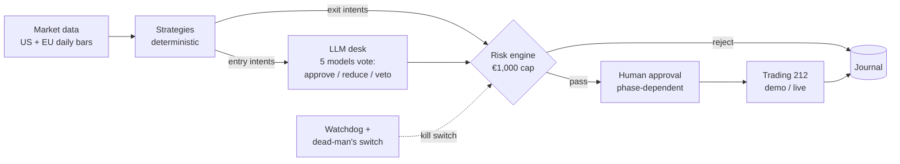

# TradeBot

Research prototype of a guarded, automated trading agent. Deterministic strategies propose trades. A multi-agent LLM desk (five models from five labs, paid and open-source) can only shrink or veto them, by majority. An independent risk engine gates every order, and a broker adapter executes. Everything runs on demo money first, capped at €1,000; real money is allowed only behind explicit gates.

> **Status (2026-09-25):** **P0 complete**: data pipeline, strategies, risk engine and backtester are built, with 53 tests. S1 (trend filter) passed its backtest gate; S2 (pullback) failed after costs. Details in the [build log](docs/10-build-log.md).
> **Not investment advice.** This is a research and engineering project. Evidence (e.g. Barber & Odean 2000) shows that active retail traders tend to underperform passive investing after costs. We judge the prototype on engineering quality and honest measurement. We promise no returns.

## Owner decisions (2026-09-24)

| Question | Decision | Consequence |
|---|---|---|
| Residency | Germany | No US-listed ETFs (use UCITS ETFs instead); German tax rules; Trading 212 as venue ([01](docs/01-platforms.md)) |
| Markets | US and EU stocks and ETFs | Xetra + US exchanges; two daily cycles ([04 §3](docs/04-architecture.md#3-runtime-cycle)) |
| Money | Demo first; real money possible later; **€1,000 cap in both** | Sizing against `min(equity, €1,000)`; fees and fractional shares drive venue choice ([05 §2](docs/05-risk-and-safety.md#2-limits)) |
| LLMs | Multi-agent system, paid + open-source, top 5 models | News analyst + 5 jurors, majority vote in code ([08](docs/08-multi-agent-llm.md)) |
| Hosting | PC 24/7 or a server | Laptop for demo (P0–P2), EU VPS before real money ([09](docs/09-hosting.md)) |

## Documents

| # | Doc | Answers |
|---|---|---|
| 01 | [Platforms, brokers & data](docs/01-platforms.md) | Where do orders go, and where does data come from? What does Germany change? Why not Trade Republic? |
| 02 | [Approaches](docs/02-approaches.md) | Rules vs ML vs RL vs LLM-as-trader vs hybrid: which one, and why? What is the LLM allowed to do? |
| 03 | [Strategies](docs/03-strategies.md) | The strategy families that exist, what we build first (S1, S2), and their exact specs at €1,000 |
| 04 | [Architecture](docs/04-architecture.md) | Components, runtime cycle, data contracts, order lifecycle, desk contract, config, repo layout, operations |
| 05 | [Risk & safety](docs/05-risk-and-safety.md) | Limits, pre-trade checks, kill switch, human approval, failure modes, drills, German tax notes |
| 06 | [Backtesting & evaluation](docs/06-backtesting.md) | How we avoid fooling ourselves: metrics, statistics, measuring the desk, promotion gates |
| 07 | [Roadmap](docs/07-roadmap.md) | Phases, deliverables, exit criteria, P0 backlog, things to confirm in the Trading 212 demo |
| 08 | [Multi-agent LLM desk](docs/08-multi-agent-llm.md) | Model landscape, the 5-model roster, pipeline, providers, cost, evaluation, safety |
| 09 | [Hosting](docs/09-hosting.md) | This PC 24/7 vs a VPS: cost, risks, checklists |
| 10 | [Build log](docs/10-build-log.md) | What was built, step by step: decisions, findings, bugs, results |

**Run it:** `uv sync` · `uv run pytest` · `uv run python -m tradebot data` · `uv run python -m tradebot backtest --strategy s1 --period insample` · `uv run python -m tradebot grid --strategy s1`. Reports land in `reports/`.
| — | [PRD-TRADE-BOT.md](PRD-TRADE-BOT.md) | The original ChatGPT-drafted PRD. **Reference only.** Where the docs above differ, they win. |

## The system in one picture

## Key decisions

| ID | Decision | Why (details in) |
|---|---|---|
| D1 | Use official broker APIs only. The bot never automates Trade Republic, which stays available for manual investing. | TR has no public API. Reverse-engineering it may breach its terms and put the account at risk ([01](docs/01-platforms.md)). |
| D2 | **Trading 212**: demo → live, one adapter. IBKR is the fallback. ETFs are UCITS only. | Official API with stop orders on live, zero commission, fractional shares, US + EU in one account. Fees decide everything at €1,000 ([01](docs/01-platforms.md)). |
| D3 | Deterministic strategies make the trade decisions. The LLMs are bounded reviewers. | Only deterministic logic can be honestly backtested. LLM backtests leak future knowledge ([02](docs/02-approaches.md)). |
| D4 | The desk is reduce-only: it can shrink or veto entries, but never enlarge an order or block an exit. | A wrong, hallucinated or injected output can then cost at most a missed trade, never an extra loss ([02](docs/02-approaches.md), [05](docs/05-risk-and-safety.md)). |
| D5 | S1 (trend filter on 6 UCITS ETFs) and S2 (pullback on 14 US + EU large caps). Long-only, daily bars, €1,000 cap. | Simple, well documented, low data needs, testable ([03](docs/03-strategies.md)). |
| D6 | One strategy code path serves backtest, shadow, demo and live. | Removes drift between backtest and live code ([04](docs/04-architecture.md)). |
| D7 | Independent risk engine, sticky kill switch, watchdog, stops held at the broker, external dead-man's switch. | Defence in depth that still works if the bot or the whole host dies ([05](docs/05-risk-and-safety.md)). |
| D8 | The LLM desk: a quarantined news analyst plus 5 jurors (Claude, GPT, Gemini, GLM, Kimi). Code takes quorum 3 and the median. Native SDKs plus OpenRouter; no LiteLLM. | Provider diversity; no single model decides; every model measured separately ([08](docs/08-multi-agent-llm.md)). |
| D9 | Laptop 24/7 for demo; EU VPS before real money. | The laptop is fine for the engine but can't host LLMs and is a weak place for live keys ([09](docs/09-hosting.md)). |
| D10 | Python 3.13, SQLite, standard library first, dependencies pinned with hashes. | Few moving parts, supply-chain hygiene ([04](docs/04-architecture.md)). |

## What changed vs the reference PRD

| PRD | Here | Why |
|---|---|---|
| Trade Republic via `pytr` | Trading 212's official API (IBKR fallback) | No public API at TR, terms-of-service risk, ban risk, silent breakage |
| €10 orders, €100 cap | €1,000 cap, €20 minimum order, fractional shares | A €1 fee on a €10 order costs 10 % each way, so the plan loses money by design |
| Codex (one model) generates signals at runtime | Deterministic signals. A 5-model desk can only reduce or veto, by majority. Coding agents write strategy code offline, through review. | Backtestability, determinism, safety, and a measurement of each model's value |
| German blue chips only | US + EU large caps and UCITS ETFs | Owner decision; US-listed ETFs are blocked for EU retail investors |
| Kill switch "cancels all pending orders" | Cancels entry orders but **keeps protective stops**. Flattening all positions is optional. | Cancelling stops leaves positions unprotected at exactly the moment something is broken |
| Fixed +5 % / −3 % exits | Exits scaled to volatility (ATR) | A fixed percentage ignores how volatile each instrument is |
| 2-year backtest | ≥ 10 years (with proxies for UCITS ETFs), an out-of-sample holdout, walk-forward testing | Two years covers a single market regime |
| Success = Sharpe > 0.5 over 3 months | Engineering gates, forward results checked against the backtest, Sharpe judged over years | The standard error of a 3-month Sharpe ratio is about 2, so the result is pure noise |

## Resolved open items (2026-09-25)

| # | Item | Decision | Details |
|---|---|---|---|
| 1 | Open-weight hosting | **OpenRouter** with zero data retention enforced account-wide and prepaid credits. Not EU-resident (EU routing is Business-plan only), which is acceptable because prompts carry no personal data. The labs' own APIs were rejected. | [08 §5](docs/08-multi-agent-llm.md#5-providers--integration) |
| 2 | GPT seat | **GPT-6 Sol** ($2 / $10 per 1M tokens, a fifth of Astra's price). Astra is scored once in the offline eval for comparison. | [08 §2](docs/08-multi-agent-llm.md#2-roster-the-top-5-as-jurors-plus-a-cheap-utility-model) |
| 3 | Monthly budget | **€0 in P0–P1, ≤ €25 in P2** (desk runtime capped at €10, eval runs at €15), **≤ €35 from P3** (+ VPS). Paid EU data only with owner approval. Enforced by the engine, prepaid credits and provider alerts. | [08 §6](docs/08-multi-agent-llm.md#6-cost) |
| 4 | News source | US: **Alpaca News API** (free). EU: **Marketaux** free plan, with company RSS as fallback. Earnings: **Finnhub** (US) and a hand-kept `events.toml` (EU). The desk now reviews **S2 entries only**; ETFs have no company news. | [08 §3.1](docs/08-multi-agent-llm.md#31-news-and-event-sources-decided-2026-09-25) |
| 5 | Trading 212 API details | Mostly answered from the API docs: GTC stops, rate limits, key permissions and IP allow-list. **No idempotency key**, which led to a new submit-once order protocol. The three undocumented behaviours are now automated P1 adapter tests. Also: Trading 212 has withheld German tax automatically since Jan 2026. | [01 §4.1](docs/01-platforms.md#41-trading-212-primary-venue), [07](docs/07-roadmap.md#trading-212-api-facts-and-p1-adapter-tests) |

**Needs you (account setup, not decisions):**
- Start of P0: create the Trading 212 practice account and a demo API key, plus a free Alpaca account for US data and news.
- Start of P2: create the LLM provider accounts and keys (Anthropic, OpenAI, Google, OpenRouter).

**Interim (2026-09-25):** until API keys are added, the Claude seats run on the owner's Claude subscription via locked-down `claude -p` ([08 §5.1](docs/08-multi-agent-llm.md#51-interim-claude-seats-on-the-owners-claude-subscription-decided-2026-09-25)). No other LLM keys are needed before P2.

**Optional:** Claude Opus 5.5 (#1 on the index, and cheaper than Opus 5) is a one-line config swap for the Claude seat.
