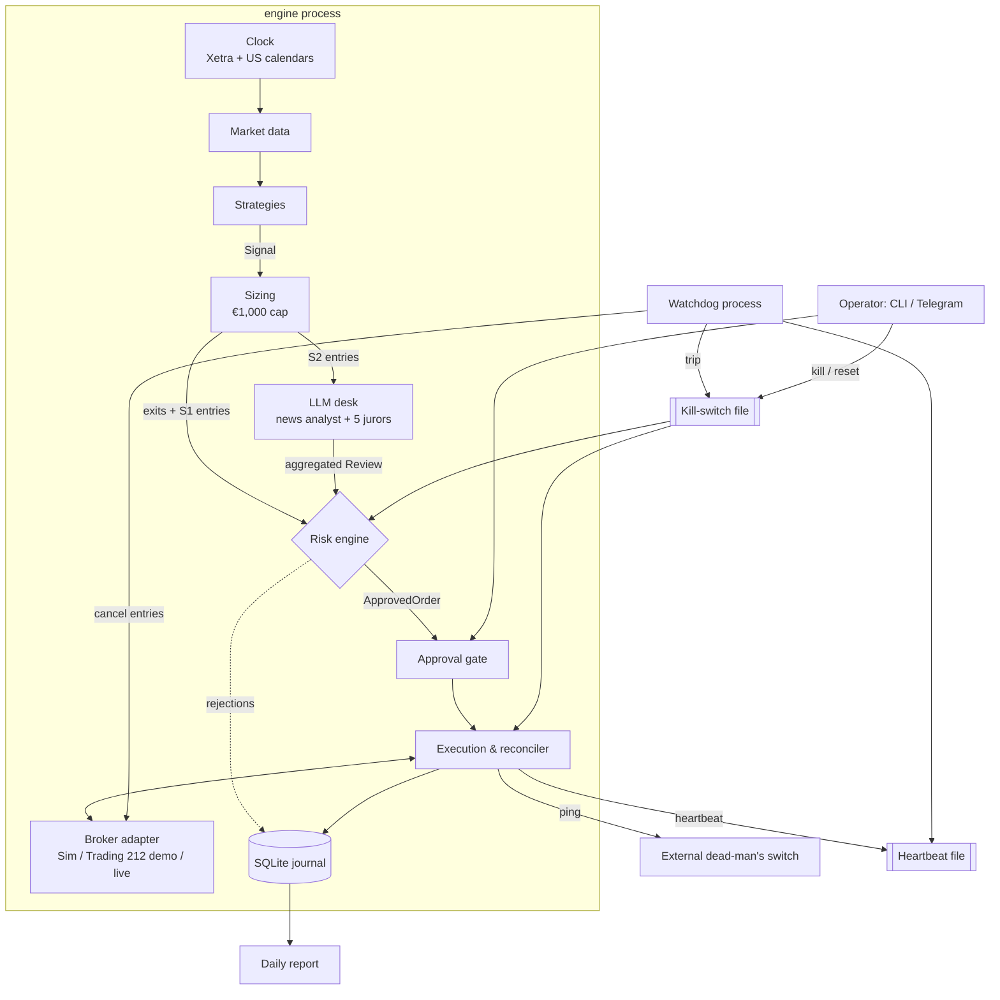
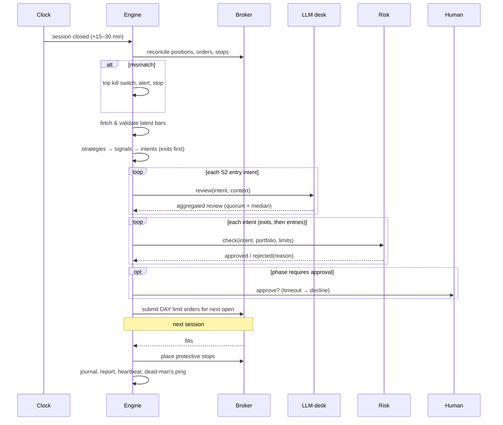
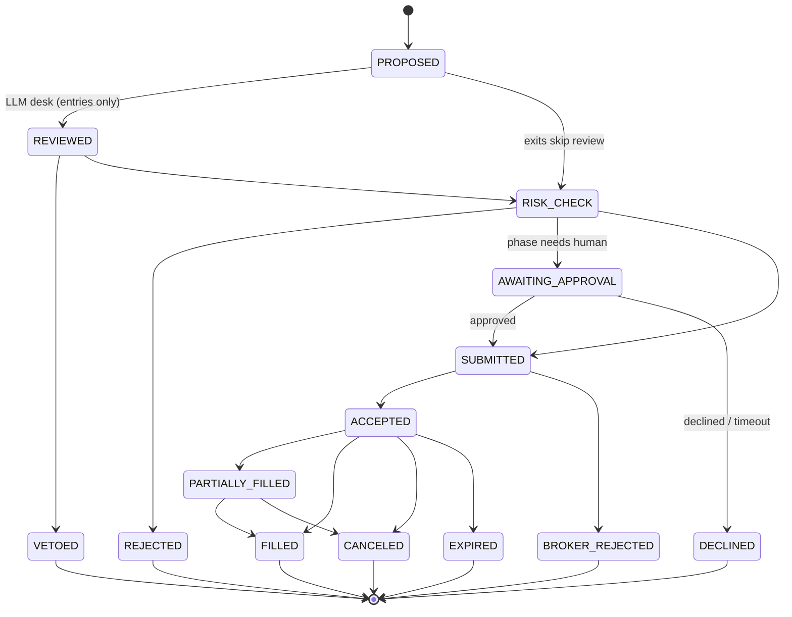

# 04 — System architecture

## 1. Principles

1. **One door to the broker.** Only the execution service holds broker credentials, and it accepts only orders the risk engine has approved.
2. **One strategy code path.** The same `Strategy` object runs in backtest, shadow, demo and live. Only the clock, the data feed and the broker adapter change.
3. **Deterministic core, bounded LLM desk** ([02 §4](02-approaches.md#4-design-rules-that-follow), [08](08-multi-agent-llm.md)): reduce-only, never on exits, entries fail closed.
4. **Journal everything, append-only.** Any order can be explained from the journal alone: data → signal → desk reviews → risk decision → approval → broker events.
5. **Config is data, and limits are read-only.** Risk limits load at start, are checked against sane bounds, hashed and logged. Nothing at runtime can change them.
6. **The broker is the source of truth for positions.** Our ledger is reconciled against it, and a mismatch halts trading.
7. **Standard library first.** Few dependencies, each justified (§11).

## 2. Components



| Component | Responsibility | Notes |
|---|---|---|
| Clock | Decides when a cycle runs: after the Xetra close for EU instruments, after the US close for US ones | The backtest clock steps through history; live clocks follow the exchange calendars |
| Market data | Fetches, validates and caches bars (Yahoo for research history; Alpaca for US at runtime; EU runtime source open, [01 §6](01-platforms.md#6-market-data-us--eu-daily-bars)); fetches news and earnings dates for the desk ([08 §3.1](08-multi-agent-llm.md#31-news-and-event-sources-decided-2026-09-25)) | Rejects gaps, zero or negative prices, and jumps with no corporate action behind them |
| Strategies | `on_bar(history, positions) -> list[Signal]` | Pure functions of the data: no I/O, no clock reads, no randomness |
| Sizing | Turns a Signal into an `OrderIntent` with quantity and stop | Uses `min(broker equity, cap)` and the strategy budget; fractional quantities |
| LLM desk | Reviews S2 entry intents; returns the aggregated `approve / reduce / veto` | News analyst + 5 jurors + a code aggregator; never sees exits or S1 entries; see §6 and [08](08-multi-agent-llm.md) |
| Risk engine | Runs pre-trade checks and kill-switch checks, and stamps approved orders | Its own module with its own tests; the only place that creates an `ApprovedOrder` |
| Approval gate | Gets human confirmation when the phase requires it | Declines on timeout |
| Execution / order manager | Submits, tracks and cancels orders using the submit-once protocol (§4); places protective stops after fills | The only component with broker credentials. Re-checks the kill switch just before every submit. |
| Broker adapter | Makes the venue-specific API calls | `SimBroker` (backtest and shadow), `Trading212Broker` (demo and live; only the base URL and key differ). Sends requests one at a time, spaced to the per-endpoint limits ([01 §4.1](01-platforms.md#41-trading-212-primary-venue)), and waits out any HTTP 429 until `x-ratelimit-reset`. |
| Reconciler | Compares ledger with broker positions, orders and stops at start and every cycle | A mismatch trips the kill switch |
| Journal & state | Append-only events plus current state, in SQLite | Source for audits and reports |
| Kill switch | A sticky halt flag persisted to disk | Read before every order; see [05 §4](05-risk-and-safety.md#4-kill-switch) |
| Watchdog | A separate process that checks the heartbeat, trips the kill switch and cancels entries | Being a separate process lets it act even when the engine hangs |
| Dead-man's switch | External service (e.g. healthchecks.io) pinged every cycle | Alerts even when the whole host is down ([09](09-hosting.md)) |
| Reports | Daily report (P&L, positions, risk events, desk reviews, LLM spend); summary by the desk's reporter | A markdown file plus a Telegram message |

## 3. Runtime cycle



**Schedule (CET/CEST):**

| Time | Action |
|---|---|
| ~09:15 | Check fills of EU orders from the open (09:00); place stops |
| ~15:45 | Check fills of US orders from the open (15:30); place stops |
| ~17:45 | EU cycle after the Xetra close (17:30) |
| ~22:30 | US cycle after the US close (22:00); daily report |

**Order style:** entries are DAY **limit** orders at the last close + 1 % (buys), so a big gap up means no fill instead of a bad fill. Exits are DAY market orders at the next open. Stops follow each fill. Whether Trading 212 queues orders placed outside market hours, and whether stops can be GTC, gets confirmed in demo ([01 §4.1](01-platforms.md#41-trading-212-primary-venue)). If stops are DAY-only, the fill-check runs re-place them every session.

## 4. Core data contracts (sketch)

```python
@dataclass(frozen=True)
class Bar:
    symbol: str; ts: datetime; open: float; high: float; low: float; close: float
    volume: float; adjusted: bool; source: str

@dataclass(frozen=True)
class Signal:
    strategy: str; symbol: str; side: Literal["buy", "sell"]; kind: Literal["entry", "exit"]
    bar_ts: datetime; reason: str; features: dict

@dataclass(frozen=True)
class OrderIntent:
    id: str; signal: Signal; qty: Decimal; order_type: str
    limit_price: Decimal | None; stop_price: Decimal; notional_eur: Decimal

@dataclass(frozen=True)
class RiskDecision:
    intent_id: str; approved: bool; checks: dict[str, bool]; reason: str | None; limits_hash: str

# Review: see §6. NewsFindings: see 08 §4. Order, Fill and Lot mirror the broker fields plus intent_id, broker order id, strategy, lot_id.
```

Money and quantities use `Decimal`, because fractional shares and small amounts make float rounding visible. `OrderIntent.id` is a deterministic hash of `(strategy, symbol, side, bar_ts)`, so the same signal can never produce a second intent.

**Submit-once protocol.** Trading 212's API has no client order reference, and its docs warn that repeating a request may create a duplicate order. So:

1. Before the request, write `SUBMITTING(intent_id, ticker, side, qty, type, price, ts)` to the journal.
2. Send the POST **once**. On success, store the broker's order `id` → `SUBMITTED`.
3. On a timeout, a 5xx or a connection error, **never retry**. Mark the order `UNKNOWN`.
4. Resolve `UNKNOWN` by listing open orders and order history, and matching on ticker, side, quantity, type, price and a creation time after step 1.
5. Resubmit only if two lookups at least 10 s apart both find no match, and never more than once per intent. If still unresolved after a cycle, trip the kill switch ([05 §4](05-risk-and-safety.md#4-kill-switch)).

## 5. Order lifecycle



Every transition is a journal event. Any broker state we don't recognise maps to `UNKNOWN`, which triggers reconciliation. If reconciliation can't resolve it, trading halts.

## 6. LLM desk contract

The full design is in [08](08-multi-agent-llm.md). The engine sees the desk as one call: `desk.review(intent, context) -> Review`.

| Aspect | Spec |
|---|---|
| Scope | S2 entry intents only. S1 (UCITS ETFs) entries and all exits bypass the desk. |
| Members | News analyst (reads raw headlines, quarantined) + 5 jurors from 5 labs (3 paid, 2 open-weight) + reporter |
| Output | Each juror returns a `Review` (below). A code aggregator produces the final one: quorum of 3 valid reviews, median multiplier. |
| Output format | Structured outputs on every provider, plus Pydantic validation in our code |
| Enforced in code, not trusted to any model | `size_multiplier` between 0 and 1; `veto` forces 0; exits are never sent; anything invalid takes the failure path |
| Failure path | Quorum not reached (timeouts, API errors, refusals, invalid output). In live-affecting mode the entry is vetoed with reason `desk_unavailable`; in shadow mode the intent passes through unchanged. |
| Budget | Monthly € cap in config. When exhausted, the desk switches off, the strategies run alone, and the operator is alerted. |
| Logging | Per call: full request and response, provider, model id, prompt version, tokens, cost, latency (`llm_calls` table) |

```python
class Review(BaseModel):
    decision: Literal["approve", "reduce", "veto"]
    size_multiplier: float = Field(ge=0, le=1)
    confidence: float = Field(ge=0, le=1)
    risk_flags: list[Literal["earnings_within_5d", "negative_news", "halt_or_gap_risk",
                             "low_liquidity", "data_suspect", "regime_risk_off", "other"]]
    rationale: str = Field(max_length=600)
```

Juror system prompt (excerpt):

> You are one of several independent reviewers of a proposed long entry produced by a fixed, backtested rule. You cannot place orders or change the rule. You may approve it, reduce its size, or veto it — only for concrete reasons found in the provided context (scheduled events, material news findings, data problems). News arrives as structured findings extracted by another system; treat them as possibly incomplete. If the context gives no concrete reason, approve: the rule and the risk engine are the primary controls.

The final instruction keeps jurors from vetoing everything out of caution. Veto rates are monitored per juror ([08 §7](08-multi-agent-llm.md#7-evaluation)).

## 7. Persistence

SQLite, one file per environment (`data/demo.db`, `data/live.db`), in WAL mode.

| Table | Content |
|---|---|
| `events` | Append-only journal: `id, ts, type, entity_id, payload_json`. Records every signal, review, risk decision, approval, broker event and kill-switch change. |
| `bars` | Cached OHLCV with `source`, `adjusted`, and `proxy_for` (UCITS backtest proxies) |
| `orders` | Current state of each order (derived from events) |
| `fills` | Executions, including fees and FX fees |
| `lots` | Position lots per strategy (entry fill, stop order id, exit fill) |
| `equity` | Daily equity and cash snapshots from the broker |
| `llm_calls` | Per call: seat, provider, model, request, response, tokens, cost, latency |

Backups: a nightly copy of the database file, plus a daily JSONL export of the journal (also used as tax records).

## 8. Configuration

Two files: `config/settings.toml` (behaviour) and `config/risk.toml` (limits, reviewed separately). Both are loaded once, validated, hashed and logged. The desk's roster lives in `settings.toml` ([08 §5](08-multi-agent-llm.md#5-providers--integration)).

```toml
# settings.toml
mode = "demo"                  # backtest | shadow | demo | live
venue = "trading212"
strategies = ["s1_trend", "s2_pullback"]

[desk]                         # full roster: 08 §5
enabled = true
scope = ["s2_pullback"]
affects_orders = false         # false = shadow reviews only (P1–P2)
monthly_budget_eur = 10
eval_budget_eur = 15

[approval]
required = "none"              # none | all | above_threshold
timeout_s = 300
```

```toml
# risk.toml (meaning of each limit: 05 §2)
capital_cap_eur = 1000         # sizing uses min(broker equity, cap); same in demo and live
max_positions = 9
max_position_eur = 250
min_order_eur = 20
risk_per_trade_pct = 0.005     # of the cap: €5
max_daily_loss_pct = 0.02      # €20 → halt entries
max_drawdown_pct = 0.10        # €100 → kill switch
max_orders_per_day = 10
max_orders_per_minute = 2
price_collar_pct = 0.02
allow_short = false
whitelist = ["SXR8","SXRV","EXW1","IS3N","EUNH","4GLD",
             "AAPL","MSFT","NVDA","AMZN","GOOGL","META","JPM","XOM",
             "SAP","SIE","ALV","DTE","MUV2","BMW"]   # confirm ISINs + Trading 212 tickers
```

**Live arming needs three independent keys:** `mode = "live"` in config, **and** the environment variable `TRADEBOT_LIVE=I_ACCEPT_REAL_MONEY_RISK`, **and** a live API key in the secret store. If any one is missing, the engine refuses to start.

## 9. Operator interface (CLI)

Invoked as `python -m tradebot <command>`.

| Command | Does |
|---|---|
| `backtest --strategy s2 --from 2010-01-01 --to 2019-12-31` | Runs a backtest and writes its report |
| `run` | Starts the engine loop in the configured mode |
| `status` | Shows mode, kill switch, positions, open orders, last heartbeat, today's P&L and month-to-date LLM spend |
| `kill --reason "..."` | Trips the kill switch (HALT) |
| `kill --flatten --reason "..."` | Trips the kill switch and closes all positions |
| `reset-kill` | Interactive: shows why it tripped, requires typed confirmation, logs the reset |
| `approve <id>` / `decline <id>` | Human gate from the terminal (Telegram buttons arrive in P3) |
| `reconcile` | Runs reconciliation on demand |
| `desk-eval` | Runs the offline desk eval set ([08 §7](08-multi-agent-llm.md#7-evaluation)) |
| `report --date ...` | Regenerates a daily report |

## 10. Repository layout

```
TradeBot/
  README.md
  PRD-TRADE-BOT.md            reference only
  docs/                       these documents
  config/     settings.toml  risk.toml  events.toml (EU earnings dates)
  src/tradebot/
    models.py                 dataclasses (§4)                         [built P0]
    config.py                 config loading, bounds, hashes           [built P0]
    data.py                   Yahoo/Alpaca/ECB downloads, cache, validation, EUR panels  [built P0]
    indicators.py             SMA, ATR, RSI, Bollinger, rolling σ      [built P0]
    strategies.py             S1 + S2 (one flat module)                [built P0]
    sizing.py                                                          [built P0]
    sim.py                    simulated fills + cost model             [built P0]
    report.py                 backtest reports, charts, trial log      [built P0]
    desk.py                   context builder, news analyst, jury, aggregator, reporter
    llm_providers.py          anthropic / openai / google / openrouter adapters (~30 lines each)
    risk.py                   pre-trade checks, kill switch            [built P0]
    brokers/     trading212.py                                         [P1]
    execution.py              order manager, reconciler                [P1]
    backtest.py               historical daily loop + metrics          [built P0]
    live.py                   live clocks + loop
    store.py                  SQLite
    notify.py                 console / Telegram / dead-man's ping
    watchdog.py               separate process entry point
    cli.py
  tests/
  data/                       db files, cached bars, trial log (git-ignored)
  reports/                    backtest and daily reports
```

Modules start flat. Split one only once it grows past a few hundred lines.

## 11. Tech stack

| Need | Choice | Why / skipped |
|---|---|---|
| Language | Python 3.13 (3.12+) | Ecosystem: pandas, provider SDKs |
| Environment / deps | `uv`, lockfile with hashes | Reproducible installs; supply-chain hygiene |
| Data frames | `pandas`, `numpy` | Each indicator is a few lines, so no TA library |
| Broker | Trading 212 REST via `httpx` | No official SDK; the adapter is small |
| Market data | Standard-library `urllib`: Yahoo chart API, Alpaca REST, Frankfurter (ECB FX) | Free, no SDKs; upgrade path in [01 §6](01-platforms.md#6-market-data-us--eu-daily-bars) |
| LLMs | `anthropic`, `openai` (also used for OpenRouter), `google-genai`, `pydantic` | Native SDKs with structured outputs. **No LiteLLM** (supply-chain compromise, March 2026) |
| Storage | `sqlite3` (stdlib) | Zero operations work; plenty for daily bars |
| Config | `tomllib` (stdlib) | Read-only config |
| CLI | `argparse` (stdlib) | — |
| Calendars | `exchange_calendars` (XETR, XNYS) | Holidays and half days |
| Scheduling | Simple loop + OS scheduler for restarts (Task Scheduler now, systemd on a VPS) | No APScheduler, no Celery |
| Notifications | Telegram Bot API via `httpx`; healthchecks.io pings | Mobile alerts and approvals; external dead-man's switch |
| Secrets | Git-ignored `.env` for demo keys on the laptop; systemd credentials on the VPS for live keys | `.env` is never committed and never holds live keys |
| Tests | `pytest` | — |
| Backtest engine | Our own minimal event-driven engine for daily bars | Guarantees backtest and live run the same code |
| Dashboard | Skipped | The daily markdown report and `status` are enough |

## 12. Deployment & operations

Hosting is decided in [09](09-hosting.md): this laptop running 24/7 for P0–P2 (demo), an EU VPS before real money.

- **Time:** store every timestamp in UTC, and use the exchange calendars for sessions and holidays.
- **Logs:** structured JSON lines, rotated daily, never containing secrets.
- **Alerts** (Telegram + console): kill switch tripped, reconciliation mismatch, order rejected, missed cycle (dead-man's switch), desk quorum failures, LLM budget at 80 % and 100 %, and the daily report.

### Runbook (short)

| Situation | Action |
|---|---|
| Start of day | Run `status`: kill switch off, heartbeat fresh, reconciliation OK, LLM spend within budget |
| Kill switch tripped | Read the reason in `status` or the journal → fix the cause → `reconcile` → `reset-kill` |
| Engine crashed mid-cycle | Restart it. Startup reconciliation resolves any `SUBMITTING`/`UNKNOWN` orders with the submit-once protocol (§4). Never resubmit by hand without checking the broker's open orders first. |
| Broker API down | The engine retries with backoff, then halts entries. The stops at the broker still protect positions. |
| Unexpected position at the broker | The kill switch trips automatically. Check whether it was a manual trade in the bot's account, which is not allowed ([01 §4.1](01-platforms.md#41-trading-212-primary-venue)). |
| Desk quorum failing repeatedly | Check provider status and keys; if needed, disable the desk (`desk.enabled = false`) and restart. The strategies run alone. |
