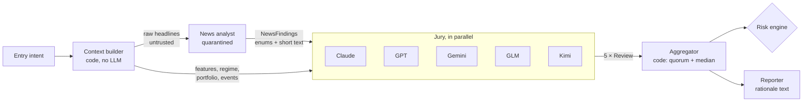

# 08 — Multi-agent LLM desk

**Owner decision (2026-09-24):** use a multi-agent system that mixes paid and open-source models, drawing on the current top 5.

**What doesn't change:** the rules in [02 §4](02-approaches.md#4-design-rules-that-follow). The desk has no broker access and no credentials. It sees entries only, can only reduce or veto them, returns schema-validated output, and fails closed. Everything is logged. Going multi-agent doesn't give the LLMs more power. It gives the veto/reduce decision more independent evidence and lets us measure which models actually help.

## 1. Model landscape (snapshot 2026-09-24)

Rankings change monthly, so the roster lives in config, not code. Scores are from the Artificial Analysis Intelligence Index, where stated.

**Proprietary**

| Lab | Model | Index | List price (in / out per 1M tokens) | Notes |
|---|---|---|---|---|
| Anthropic | Claude Opus 5.5 | 59 | $4 / $20 | Newly launched successor to Claude Opus 5 ($5 / $25); no longer "#1 overall" — Claude Fable 5.2 (65) leads the index (AA leaderboard, checked 2026-11-25) |
| Anthropic | Claude Fable 5.1 | 53 | $10 / $50 | Most capable widely released Claude; priced above Opus |
| OpenAI | GPT-6 Astra | 53 | $10 / $50 | Released 2026-09-04 |
| OpenAI | GPT-6 Sol | 48 | $2 / $10 | Released 2026-09-22 as the efficient tier |
| SpaceXAI | Grok 4.7 | 46 | *(verify)* | Alternate paid seat |
| Google | Gemini 3.8 Flash | Google's best on the index | $0.75 / $3.75 until 2026-12-31, then $1.50 / $7.50 | Released 2026-09-02; Gemini 3.5 Pro not yet out |

Meta's Muse Spark 1.3 (index 48) is **not** open-weight, whatever some aggregators say. Meta plans an open release but has given no date.

**Open-weight**

| Lab | Model | Licence | Notes |
|---|---|---|---|
| Z.ai | GLM-5.3 | Weights on Hugging Face since late Aug 2026; licence *(verify)*, GLM-5.2 was MIT | No longer "tied for #1 open-weight": index 32 (AA leaderboard, checked 2026-11-25); $1.40 / $4.40 |
| Moonshot | Kimi K3 | Weights since 2026-07-27; revenue-tiered licence (fine for personal use) | No longer "tied for #1 open-weight": Kimi K3.1 Pro is index 47 (AA leaderboard, checked 2026-11-25); $3 / $15 |
| Alibaba | Qwen3.8 (open variants) | *(verify)* | "Qwen3.8 Max" is API-only |
| DeepSeek | DeepSeek V4.1 Flash | MIT | 552B MoE with ~8–16B active; $0.30 / $1.20 at peak, half that off-peak; very cheap |

Open-weight prices are per 1M tokens as listed on OpenRouter and the labs' own APIs in September 2026.

## 2. Roster: the top 5 as jurors, plus a cheap utility model

One model per lab, so their errors are as independent as possible, and an outage at one provider can't stop the desk (quorum 3 of 5).

| Seat | Default model | Type | Why |
|---|---|---|---|
| Juror 1 | Claude Opus 5 (`claude-opus-5`). Opus 5.5 (#1 on the index) is a one-line config swap. | Paid | Top lab; reliable structured outputs |
| Juror 2 | **GPT-6 Sol** (decided 2026-09-25) | Paid | Second lab. A fifth of Astra's price ($2 / $10 vs $10 / $50) for a short structured review; Astra runs once in the offline eval (§7) for comparison |
| Juror 3 | Gemini 3.8 Flash (Grok 4.7 as alternate) | Paid, cheap | Third lab; fast |
| Juror 4 | GLM-5.3 | Open-weight | Selected for lab diversity (one model per lab), not ranking; subject to ZDR endpoint, licence and offline-eval checks |
| Juror 5 | Kimi K3 | Open-weight | Selected for lab diversity, different lab; subject to the same endpoint, licence and offline-eval checks |
| News analyst | DeepSeek V4.1 Flash | Open-weight (MIT) | Cheapest capable model; the only seat that reads raw internet text (§3) |
| Reporter | Gemini 3.8 Flash | Paid, cheap | Writes explanations and the daily summary; decides nothing, so it doesn't need the strongest model |

**Scope (decided 2026-09-25): the desk reviews S2 entries only.** S1 trades UCITS ETFs, which have no company news or earnings, on a slow monthly trend filter. Its entries go straight to the risk engine. That keeps cost down and focuses the desk's evaluation on the trades where news matters.

**Open owner decision (2026-11-25):** S2-only at an assumed 5–8 eligible entries a month makes the veto-effect measure a multi-year shadow study. The owner may choose to also review S3 breakout entries (or an approved single-stock S2 replacement such as C1) to raise the reviewed-entry rate; S4 stays an unmodified control book unless scored offline/shadow-only. This is a scope decision, not a code change, and does not by itself raise the statistical power of the S2 measure.

## 3. Pipeline (per entry intent)



1. **Context builder (code, no LLM):** assembles the intent, the price features, and a *deterministic* market regime (index vs SMA200, 20-day realised-volatility percentile). It adds portfolio weights, the next earnings date, and headlines from the last 3 days, fetched only from the allow-listed sources in §3.1. Whatever code can compute, code computes. No LLM does arithmetic or regime detection.
2. **News analyst (quarantine):** the **only** agent that sees raw internet text. It turns headlines into `NewsFindings`, a schema made mostly of enums with ≤ 200-character summaries, so instructions hidden in a headline have nowhere to travel. Downstream agents never see raw text.
3. **Jury:** five models, each called independently with the same versioned prompt and the same context, the `NewsFindings`, not raw news. Each returns a `Review` ([04 §6](04-architecture.md#6-llm-desk-contract)). Calls run in parallel with a 60 s timeout each.
4. **Aggregator (code):**
   - `valid` = the reviews that parsed and passed validation.
   - If fewer than 3 are valid, the desk has failed and the failure path runs (entries fail closed).
   - `final_multiplier = median(multipliers)`, where a veto counts as 0. A veto therefore needs a **majority** (≥ 3 of 5), and no single model can veto or approve alone.
   - If ≥ 2 jurors raise `data_suspect`, the entry is skipped and the operator alerted.
   - Code then clamps the result to [0, 1] and passes it to the risk engine.
5. **Reporter:** writes a 3–5 line rationale for the approval prompt and the daily report, working only from the structured outputs.

### 3.1 News and event sources (decided 2026-09-25)

| Need | Source | Cost | Notes |
|---|---|---|---|
| Headlines, US stocks | **Alpaca News API** (Benzinga) | Free; 200 calls/min | Same free Alpaca account as the US price data. History back to 2015, which also feeds the offline eval set (§7). |
| Headlines, EU stocks | **Marketaux** (free plan) | Free; 100 requests/day | Global entity-tagged news. A call is made only when an S2 entry exists (a few per day at most). Coverage of the six Xetra names is tested at the start of P2; fallback: the companies' own press-release RSS feeds. |
| Earnings dates, US stocks | **Finnhub** earnings calendar (free plan) | Free; 60 calls/min | Covers US-listed stocks |
| Earnings dates, EU stocks | **`config/events.toml`**, maintained by hand from each company's investor-relations financial calendar | Free | Six companies × 4 dates a year. The engine warns when a company has no future date on file. |

Adding a source means adding it to this allow-list; the context builder fetches nothing else.

**Why the aggregator is code, not an LLM "chair":** a median over a quorum is deterministic, auditable and robust to one compromised or hallucinating model. An LLM chair would be another single point of failure and another injection target.

**Considered and deferred** (possible P2b experiments, only if the jury shows value): bull/bear debate rounds as in TradingAgents, and role-specialised analysts (fundamentals, technicals). Technicals and regime are computed by code anyway.

## 4. Schemas

```python
class NewsItem(BaseModel):
    source_id: str                     # id assigned by the context builder, not free text
    event: Literal["earnings", "guidance", "m_and_a", "legal_regulatory", "management",
                   "product", "macro", "analyst_rating", "other"]
    direction: Literal["positive", "negative", "neutral", "unclear"]
    materiality: int = Field(ge=1, le=3)
    summary: str = Field(max_length=200)

class NewsFindings(BaseModel):
    items: list[NewsItem] = Field(max_length=10)
    earnings_within_5d: bool

# Juror output: Review, see 04 §6
```

## 5. Providers & integration

- **Paid labs use their native SDKs:** `anthropic`, `openai`, `google-genai`. Each supports schema-constrained output. For Claude that's structured outputs via `client.messages.parse()` with the Pydantic model. Our code validates every response with Pydantic regardless of provider.
- **Open-weight models run on OpenRouter (decided 2026-09-25).** This PC (i5-7200U, 8 GB RAM, no GPU) can't run them, and the leading open models (500B–2.8T parameters) need multi-GPU servers ([09](09-hosting.md)). OpenRouter is OpenAI-compatible, so it works with the `openai` SDK and a different base URL.
  - **Zero data retention enforced account-wide**, so requests only go to upstream providers that keep nothing. Every pinned open-weight checkpoint id must be confirmed ZDR-eligible on the day P2 starts; if a pinned id has no eligible route, the seat fails closed rather than silently dropping ZDR.
  - **Prepaid credits**, which act as a hard spending cap. There's no per-token markup, only a 5.5 % fee on credit purchases.
  - **Not EU-resident:** OpenRouter's EU in-region routing is limited to Business/Enterprise plans, so an individual account routes globally. That's acceptable here because prompts contain only public market data and intended trades, no personal data.
  - If a roster model has no ZDR-compliant endpoint, swap that seat for another open-weight model that has one (e.g. GLM-5.3-Flash) rather than turning ZDR off.
  - **ZDR re-check (2026-11-25):** `z-ai/glm-5.3` (42), `moonshotai/kimi-k3.1-pro` (27) and `deepseek/deepseek-v4.1-flash-1017` (47) each have OpenRouter ZDR endpoints (live endpoint list, checked 2026-11-25). OpenRouter announced CSAM screening of ZDR traffic (2026-10-27), which can retain flagged content for review or legal preservation; "no impact on market-data prompts" is not a contractual guarantee. Native seats are governed by their own terms: Google AI Studio paid tier and the standard Anthropic API prohibit training but retain abuse/safety logs (Anthropic 30-day default; strict ZDR needs enterprise approval). The Google Vertex "Safety Retention since 2026-10-18" change is UNVERIFIED here.
  - **Rejected:** the labs' own APIs (DeepSeek, Z.ai, Moonshot). They're slightly cheaper, but their retention terms are weaker and data is processed in China, with nothing much to gain at this volume.
- **No LiteLLM.** Its PyPI package was compromised in a supply-chain attack in March 2026. A system holding broker keys shouldn't depend on a multi-provider router library. Each adapter is ~30 lines, and all dependencies are pinned with hashes in `uv.lock`.
- **Keys:** one per provider (or one for OpenRouter) in the OS keyring or systemd credentials, each with a **hard spend cap set in the provider's console**.
- **Pinning:** log the exact model id, provider and date with every call. Treat a model version change like a code change: re-run the offline eval set (§7) before switching.

### 5.1 Interim: Claude seats on the owner's Claude subscription (decided 2026-09-25)

Until API keys are added, the Claude juror and the reporter run through **Claude Code in headless mode (`claude -p`)**, logged in with the owner's Claude subscription. The news analyst can too (`--model sonnet`) until OpenRouter is set up. Anthropic allows this for personal projects, but not for products offered to others. How headless use is metered changed during 2026, but the desk's volume (a few dozen short calls a month) is small either way. It costs nothing extra.

**The catch:** without `--bare`, which only works with an API key, `claude -p` loads the owner's whole Claude Code setup. That includes hooks, plugins, MCP servers, claude.ai connectors (mail, calendar, drive) and tools such as Bash. A juror must have none of that. The adapter therefore:

- runs from an empty working directory with `--setting-sources project` (no user hooks or plugins), `--strict-mcp-config` (no MCP servers or connectors), `--disallowedTools "*"` (no tools at all), `--disable-slash-commands`, `--no-session-persistence` and `--max-turns 1`;
- replaces Claude Code's system prompt with the juror prompt (`--system-prompt-file`) and asks for `--json-schema` output (the `Review` schema), with `--model opus` and `--output-format stream-json --verbose`;
- **reads the session's `system/init` report and discards the result unless its tool, MCP-server and plugin lists are all empty.** The flags aren't trusted blindly;
- logs the exact model the run reports. The `opus` alias moves when Anthropic ships a new model, so the eval set (§7) re-runs whenever it changes.

Limits of the interim:

- It covers only the Claude seats. One juror can't reach the quorum of 3, so the desk stays in shadow mode and can't affect orders (the P2 default anyway).
- It works only on a machine logged into Claude Code. That's fine on the laptop for P0–P2. Before real money moves to the VPS, the Claude seat switches to an API key.
- If the subscription's limits are reached, the call fails and the desk fails closed; the strategies keep running.
- Possible extension (unchecked): OpenAI's Codex CLI (ChatGPT plan) and Google's Gemini CLI have similar headless modes and might cover the GPT and Gemini seats the same way. Check their terms before relying on them.

Config sketch (model ids are placeholders, verify each against provider docs):

```toml
[desk]
enabled = true
scope = ["s2_pullback"]           # S1 (UCITS ETFs) skips the desk
affects_orders = false            # shadow until the P2 gate
quorum = 3
timeout_s = 60
monthly_budget_eur = 10           # runtime hard cap; when exhausted → strategy-only + alert
eval_budget_eur = 15              # separate monthly cap for `desk-eval` runs
on_failure = "veto"               # entries fail closed

[desk.news_analyst]
provider = "openrouter"; model = "deepseek/deepseek-v4.1-flash"    # verify id

[desk.reporter]
provider = "google";     model = "gemini-3.8-flash"               # verify id

[[desk.jurors]]
provider = "anthropic";  model = "claude-opus-5"
[[desk.jurors]]
provider = "openai";     model = "gpt-6-sol"                      # verify id
[[desk.jurors]]
provider = "google";     model = "gemini-3.8-flash"               # verify id
[[desk.jurors]]
provider = "openrouter"; model = "z-ai/glm-5.3"                   # verify id
[[desk.jurors]]
provider = "openrouter"; model = "moonshotai/kimi-k3"             # verify id
```

## 6. Cost

Per review, assuming ~5k input and ~2k output+thinking tokens per juror, ~8k/1k for the news analyst, and September 2026 list prices:

| Seat | ≈ cost per review |
|---|---|
| Claude Opus 5 ($5 / $25) | $0.075 |
| GPT-6 Sol ($2 / $10) | $0.030 |
| Gemini 3.8 Flash ($0.75 / $3.75; doubles in 2027) | $0.011 |
| GLM-5.3 ($1.40 / $4.40) | $0.016 |
| Kimi K3 ($3 / $15) | $0.045 |
| DeepSeek V4.1 Flash, news ($0.30 / $1.20 peak) | $0.004 |
| **Total** | **≈ $0.18** (≈ $0.30 with GPT-6 Astra) |

All five jurors are reasoning models, so a review's real cost depends on the provider's `reasoning effort` and output-token cap, not just on the visible answer. Set these per provider (native `max_output_tokens` / `max_tokens` include reasoning tokens, not only visible output, and the field differs by SDK — OpenAI, Anthropic, Google and OpenRouter are configured separately), pin effort low, and apply a hard output-token cap. Without this, thinking tokens can dwarf the visible rationale and one review can cost several times the table figure. Low effort and a small cap are evaluation candidates, not proven quality settings. Log token usage and cost per call (`llm_calls`); the budget guard alerts before the monthly cap is exhausted. The table above is a dated estimate until each selected endpoint's price and capability are verified (checked 2026-11-25).

**Monthly research budget (decided 2026-09-25):**

| Phase | Item | Expected | Hard cap |
|---|---|---|---|
| P0–P1 | Data (Yahoo, Alpaca, Frankfurter), Trading 212 demo, Telegram, healthchecks.io | €0 | — |
| P2+ | Desk runtime: ~8–12 S2 reviews (~$2) + 22 daily reports by Gemini Flash (~$0.25) | ≈ €2–3 | **€10** (`monthly_budget_eur`) |
| P2+ | Offline eval runs (one full run: 50 contexts + determinism checks ≈ $13; one Astra comparison ≈ $6) | ≈ €12 in months with a model or prompt change, otherwise €0 | **€15** (`eval_budget_eur`) |
| P3+ | EU VPS ([09](09-hosting.md)) | ≈ €6–10 | provider plan |
| — | Paid EU price data (EODHD, ~€20) | €0 | only with owner approval (see the EU runtime-data decision in [10, step 11](10-build-log.md#step-11-backtest-results-and-the-p0-gate)) |
| **Total** | | **€0 in P0–P1, ≤ €25 in P2, ≤ €35 from P3** | |

Against a €1,000 cap, even €3 a month is ~4 % a year, more than a realistic trading edge. Consequences:

- Desk spend is a **research cost**, reported separately, not expected to be paid for by trading P&L.
- **Caps are enforced in three places:** the engine's budget guard (per month, per budget), prepaid credits where the provider offers them (OpenRouter, Anthropic, OpenAI), and budget alerts where it only alerts. When the runtime budget runs out, the desk switches off, the strategies run alone (book A), and the operator is alerted. When the eval budget runs out, `desk-eval` refuses to run.
- After P2, each juror keeps its seat only if it's cost-effective (§7).

## 7. Evaluation

This extends [06 §6](06-backtesting.md#6-evaluating-the-llm-desk-forward-only).

- **Per-juror scorecard:** veto/reduce rate; veto precision (vetoed entries that would have lost, vs the base loss rate); agreement with the majority; calibration (Brier score of `confidence` against "trade loses"); failure rate; latency; cost.
- **Counterfactual books in shadow**, all computed for free from the same signals: A = strategies only; B = desk ensemble; one book per juror acting alone.
- **Offline eval set** (before P2 and on every model/prompt change): ~50 frozen historical S2 contexts *dated after every model's training cutoff*, with headlines from the Alpaca News API history, plus the injection test set ([05 §8](05-risk-and-safety.md#8-llm-specific-controls)). It checks schema validity, determinism (3 runs on 10 of the contexts), and injection resistance. Profitability is not tested here. The first run also scores GPT-6 Astra in the GPT seat, to check that Sol isn't losing anything that matters.
- **Decision at the P2 gate:** keep all five, shrink to the best 2–3, or keep the LLMs advisory only (reports). "The LLMs don't help" is a valid research result.

**Evidence that model choice matters:** in Nof1's Alpha Arena (Oct–Nov 2025), six LLMs each traded $10,000 of real money in crypto perpetuals, fully autonomously. Qwen3 Max and DeepSeek finished ahead, while four of the six lost money, some more than 60 %. Outcomes varied widely between models, and unbounded autonomy was fragile. That supports a bounded role and per-model measurement.

## 8. Safety specifics for multi-agent

- **Quarantine:** only the news analyst reads raw text. Downstream agents get enums and capped strings.
- **No tools, no agent-to-agent calls:** code orchestrates everything, and no agent can trigger another.
- **Quorum + median:** no single model decides anything.
- **Provider diversity:** limits correlated failures and single-vendor outages.
- **Injection tests run against the whole desk**, not just one model.
- **Budget and spend caps** stop a runaway loop from turning into a bill.

## Sources

- Artificial Analysis: [leaderboard](https://artificialanalysis.ai/leaderboards/models) · [Intelligence Index](https://artificialanalysis.ai/evaluations/artificial-analysis-intelligence-index)
- OpenAI: [GPT-6 Astra](https://openai.com/index/gpt-6-astra/) · [GPT-6 Sol and Luna (TechCrunch)](https://techcrunch.com/2026/09/22/openai-launches-gpt-6-sol-and-luna/)
- Google: [Gemini API changelog](https://ai.google.dev/gemini-api/docs/changelog) · [Gemini 3.5 Pro status (Fortune)](https://fortune.com/2026/09/03/google-shipped-four-gemini-flash-models-in-106-days-but-its-flagship-frontier-model-is-still-nowhere-to-be-seen/)
- Meta: [Muse Spark 1.3 (VentureBeat)](https://venturebeat.com/technology/meta-says-muse-spark-1-3-has-frontier-performance-but-its-best-results-come-from-a-model-developers-cant-broadly-use-yet)
- Z.ai / Moonshot: [GLM-5.3 on Hugging Face](https://huggingface.co/zai-org/GLM-5.3) · [GLM-5.3 open-weight release](https://creati.ai/ai-news/2026-08-20/glm-5-3-ties-for-the-open-model-lead-as-z-ai-delays-its-open-weight-release/)
- DeepSeek: [V4.1 Flash (DataNorth)](https://datanorth.ai/news/deepseek-releases-deepseek-v4-1-flash)
- OpenRouter: [Zero Data Retention](https://openrouter.ai/docs/guides/features/zdr) · [pricing overview](https://www.truefoundry.com/blog/openrouter-pricing) · [in-region routing (Business/Enterprise)](https://openrouter.ai/docs/guides/features/sovereign-ai)
- Prices: [GPT-6 Sol and Luna (VentureBeat)](https://venturebeat.com/technology/openai-releases-gpt-6-sol-and-luna-models-slashing-api-costs-50-or-more) · [Gemini API pricing](https://ai.google.dev/gemini-api/docs/pricing) · [Gemini 3.8 Flash intro pricing](https://apidog.com/blog/gemini-3-8-flash-pricing/) · [open-weight API prices](https://www.morphllm.com/llm-api)
- News and events: [Alpaca historical news](https://docs.alpaca.markets/us/docs/historical-news-data) · [Alpaca News API launch](https://alpaca.markets/blog/introducing-news-api-for-real-time-fiancial-news/) · [Marketaux pricing](https://www.marketaux.com/pricing) · [Finnhub earnings calendar](https://finnhub.io/docs/api/earnings-calendar)
- LiteLLM compromise: [LiteLLM security update](https://docs.litellm.ai/blog/security-update-march-2026) · [Datadog Security Labs](https://securitylabs.datadoghq.com/articles/litellm-compromised-pypi-teampcp-supply-chain-campaign/)
- Alpha Arena: [Season 1 results](https://www.iweaver.ai/blog/alpha-arena-ai-trading-season-1-results/) · [ForkLog](https://forklog.com/en/four-out-of-six-ai-models-suffer-losses-in-trading-tournament/)
