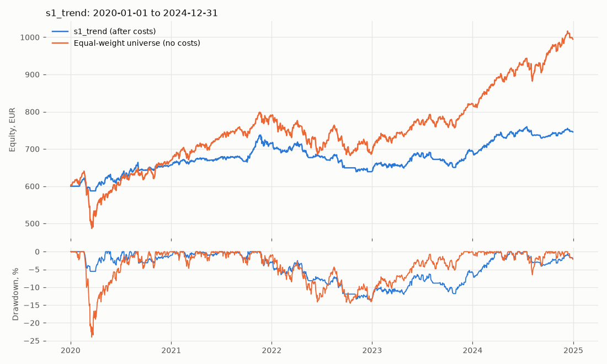

# Backtest: s1_trend, holdout (2020-01-01 to 2024-12-31)

Generated 2026-09-25 18:35 · code `75445e5c1b44` · docs/06 method

## Setup

- **Parameters:** `{"sma_n": 200, "atr_n": 20, "atr_mult": 3.0, "vol_n": 20, "check": "M", "max_positions": 6, "max_position_eur": 250.0}`
- **Universe:** SXR8, SXRV, EXW1, IS3N, EUNH, 4GLD
- **Instruments starting later than the period:** none
- **Proxy history used:** none
- **Data:** Yahoo daily bars, dividend-adjusted, converted to EUR at ECB rates (docs/10 step 4)
- **Execution:** signal at close, entries as DAY limit (close + 1 %) at the next open, exits at the next open, resting stops (gap-through fills at the open). Costs per docs/06 §2.3, and again at 2×.
- Budget: €600 of the €1,000 cap.

## Metrics

| Metric | Strategy (1× costs) | Strategy (2× costs) | Benchmark |
|---|---|---|---|
| CAGR | +4.5% | +3.8% | +10.6% |
| Final equity, EUR | 746 | 724 | 995 |
| Sharpe (± standard error) | 0.71 ± 0.50 | 0.61 | 0.87 |
| Sortino | 0.99 | 0.85 |  |
| Volatility | 6.3% | 6.4% |  |
| Max drawdown | -13.4% | -14.0% | -24.0% |
| Longest drawdown, days | 602 | 657 |  |
| Calmar | 0.33 | 0.28 |  |
| Exposure (time invested) | 57% | 57% | 100% |
| Trades (open at end) | 89 (4) | 88 |  |
| Win rate | 38% | 36% |  |
| Avg win / avg loss, EUR | 9.89 / -3.68 | 10.19 / -3.81 |  |
| Profit factor | 1.66 | 1.53 |  |
| Avg bars held | 39.4 | 38.4 |  |
| Costs, EUR (% of gross P&L) | 23 (+14.8%) | 47 (+29.4%) |  |
| Turnover, x per year | 6.9 | 7.0 |  |
| Correlation / beta to benchmark | 0.62 / 0.32 |  |  |

Risk engine: 4 entry orders unfilled (gap above the limit); rejections: sizing: below minimum order ×10.

Kill switch (drawdown ≥ 10 % of the strategy budget from peak) would have tripped on: **2022-05-16**. The backtest keeps trading after that date, so the full history stays visible. Live, trading would halt there.

## Returns per year

| Year | Strategy | Benchmark |
|---|---|---|
| 2020 | +9.5% | +11.0% |
| 2021 | +8.9% | +17.9% |
| 2022 | -10.7% | -12.9% |
| 2023 | +8.9% | +19.6% |
| 2024 | +7.1% | +21.0% |

## Trades

| Symbol | Trades | P&L, EUR | Win rate |
|---|---|---|---|
| IS3N | 12.0 | -12.42 | 25% |
| EUNH | 12.0 | -2.85 | 33% |
| EXW1 | 16.0 | +4.11 | 38% |
| 4GLD | 17.0 | +5.09 | 35% |
| SXR8 | 17.0 | +45.37 | 41% |
| SXRV | 15.0 | +94.52 | 53% |

Exit reasons: protective stop ×88, trend lost: close <= SMA ×1

**Top 5 winners:** SXR8 2023-11-01→2024-04-16 +47.52 €; SXRV 2020-05-04→2020-09-04 +44.64 €; SXRV 2023-04-03→2023-08-09 +28.91 €; 4GLD 2021-10-01→2022-05-16 +20.47 €; SXR8 2021-10-01→2022-01-10 +18.22 €

**Top 5 losers:** SXR8 2022-05-02→2022-05-12 -11.77 €; SXR8 2022-08-01→2022-09-22 -11.53 €; SXRV 2022-04-01→2022-04-22 -10.55 €; EXW1 2022-12-01→2022-12-15 -9.71 €; 4GLD 2022-08-01→2022-09-16 -9.52 €

## Monte Carlo (1,000 reshuffles of the trade order)

Max drawdown: median €45, 95th percentile €71, worst €110 (closed-trade P&L, starting from €600).

