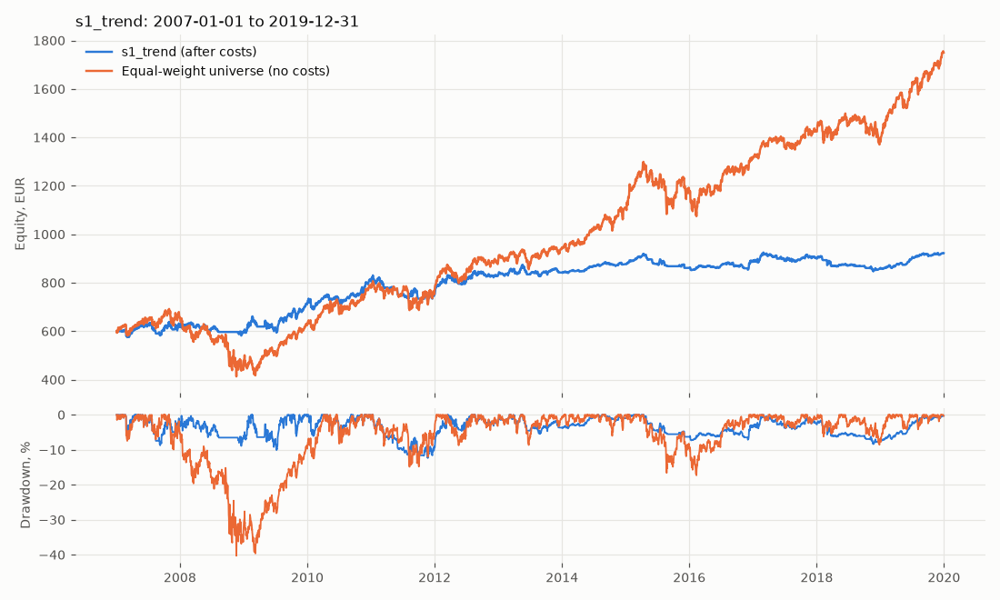

# Backtest: s1_trend, insample (2007-01-01 to 2019-12-31)

Generated 2026-09-25 18:32 · code `0be3a594cfcb` · docs/06 method

## Setup

- **Parameters:** `{"sma_n": 200, "atr_n": 20, "atr_mult": 3.0, "vol_n": 20, "check": "M", "max_positions": 6, "max_position_eur": 250.0}`
- **Universe:** SXR8, SXRV, EXW1, IS3N, EUNH, 4GLD
- **Instruments starting later than the period:** EUNH (2013-01-02)
- **Proxy history used:** SXR8 (2007-01-03 to 2013-12-31), SXRV (2007-01-03 to 2013-12-31), EXW1 (2007-01-03 to 2008-12-31), IS3N (2007-01-03 to 2014-06-10), 4GLD (2007-01-03 to 2009-11-12)
- **Data:** Yahoo daily bars, dividend-adjusted, converted to EUR at ECB rates (docs/10 step 4)
- **Execution:** signal at close, entries as DAY limit (close + 1 %) at the next open, exits at the next open, resting stops (gap-through fills at the open). Costs per docs/06 §2.3, and again at 2×.
- Budget: €600 of the €1,000 cap.

## Metrics

| Metric | Strategy (1× costs) | Strategy (2× costs) | Benchmark |
|---|---|---|---|
| CAGR | +3.4% | +2.9% | +8.6% |
| Final equity, EUR | 922 | 875 | 1,750 |
| Sharpe (± standard error) | 0.45 ± 0.29 | 0.40 | 0.56 |
| Sortino | 0.64 | 0.56 |  |
| Volatility | 7.9% | 8.0% |  |
| Max drawdown | -12.4% | -13.1% | -40.3% |
| Longest drawdown, days | 715 | 1197 |  |
| Calmar | 0.27 | 0.23 |  |
| Exposure (time invested) | 49% | 50% | 100% |
| Trades (open at end) | 210 (3) | 211 |  |
| Win rate | 43% | 40% |  |
| Avg win / avg loss, EUR | 8.39 / -3.67 | 8.72 / -3.66 |  |
| Profit factor | 1.71 | 1.57 |  |
| Avg bars held | 44.2 | 43.8 |  |
| Costs, EUR (% of gross P&L) | 54 (+14.7%) | 109 (+29.0%) |  |
| Turnover, x per year | 5.3 | 5.4 |  |
| Correlation / beta to benchmark | 0.51 / 0.23 |  |  |

Risk engine: 24 entry orders unfilled (gap above the limit); rejections: sizing: below minimum order ×3.

Kill switch (drawdown ≥ 10 % of the strategy budget from peak) would have tripped on: **2009-06-23**. The backtest keeps trading after that date, so the full history stays visible. Live, trading would halt there.

## Returns per year

| Year | Strategy | Benchmark |
|---|---|---|
| 2007 | +3.0% | +9.7% |
| 2008 | -2.8% | -29.0% |
| 2009 | +18.5% | +34.2% |
| 2010 | +13.3% | +24.7% |
| 2011 | -6.7% | -2.1% |
| 2012 | +10.6% | +16.9% |
| 2013 | +1.3% | +6.0% |
| 2014 | +4.1% | +17.3% |
| 2015 | -1.8% | +7.1% |
| 2016 | +2.9% | +10.5% |
| 2017 | +1.7% | +8.6% |
| 2018 | -4.8% | -2.6% |
| 2019 | +7.5% | +26.1% |

## Trades

| Symbol | Trades | P&L, EUR | Win rate |
|---|---|---|---|
| EXW1 | 43.0 | -9.00 | 35% |
| IS3N | 30.0 | +31.32 | 43% |
| EUNH | 23.0 | +35.28 | 30% |
| SXR8 | 40.0 | +62.14 | 48% |
| SXRV | 40.0 | +72.27 | 52% |
| 4GLD | 34.0 | +122.29 | 44% |

Exit reasons: protective stop ×200, trend lost: close <= SMA ×10

**Top 5 winners:** IS3N 2009-05-01→2010-01-26 +45.52 €; SXRV 2011-11-01→2012-05-08 +43.02 €; 4GLD 2007-12-03→2008-03-19 +34.58 €; SXR8 2009-10-01→2010-05-06 +29.68 €; 4GLD 2010-08-02→2011-01-14 +26.66 €

**Top 5 losers:** SXRV 2009-05-01→2009-05-22 -19.25 €; IS3N 2008-06-02→2008-06-09 -14.82 €; EXW1 2007-12-03→2008-01-15 -12.88 €; SXRV 2011-08-01→2011-08-03 -12.07 €; IS3N 2007-12-03→2008-01-16 -11.98 €

## Monte Carlo (1,000 reshuffles of the trade order)

Max drawdown: median €56, 95th percentile €88, worst €148 (closed-trade P&L, starting from €600).

