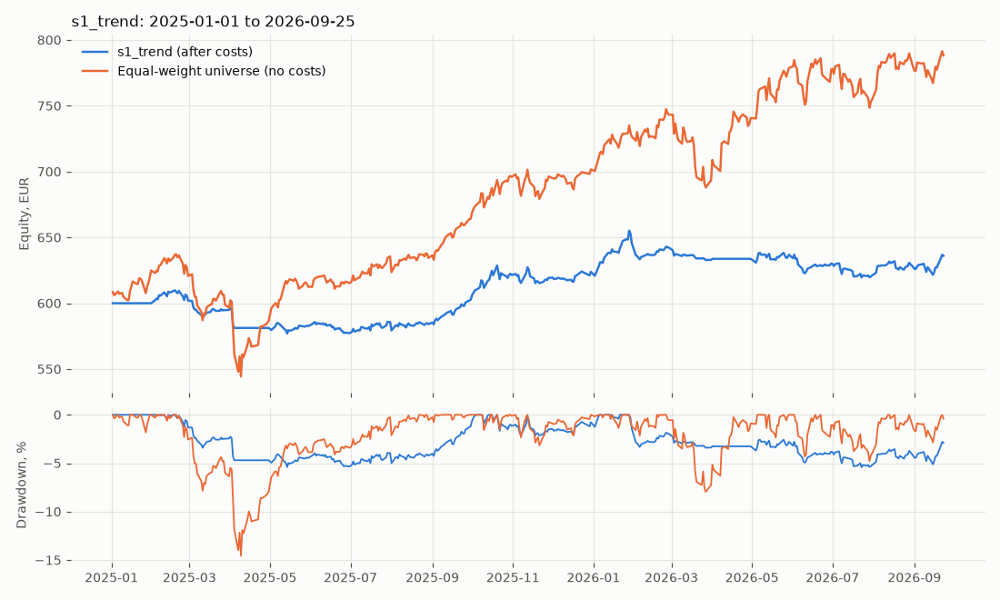

# Backtest: s1_trend, recent (2025-01-01 to 2026-09-25)

Generated 2026-09-25 18:36 · code `75445e5c1b44` · docs/06 method

## Setup

- **Parameters:** `{"sma_n": 200, "atr_n": 20, "atr_mult": 3.0, "vol_n": 20, "check": "M", "max_positions": 6, "max_position_eur": 250.0}`
- **Universe:** SXR8, SXRV, EXW1, IS3N, EUNH, 4GLD
- **Instruments starting later than the period:** none
- **Proxy history used:** none
- **Data:** Yahoo daily bars, dividend-adjusted, converted to EUR at ECB rates (docs/10 step 4)
- **Execution:** signal at close, entries as DAY limit (close + 1 %) at the next open, exits at the next open, resting stops (gap-through fills at the open). Costs per docs/06 §2.3, and again at 2×.
- Budget: €600 of the €1,000 cap.

## Metrics

| Metric | Strategy (1× costs) | Strategy (2× costs) | Benchmark |
|---|---|---|---|
| CAGR | +3.4% | +2.7% | +16.2% |
| Final equity, EUR | 636 | 628 | 788 |
| Sharpe (± standard error) | 0.65 ± 0.84 | 0.51 | 1.28 |
| Sortino | 0.92 | 0.71 |  |
| Volatility | 5.4% | 5.4% |  |
| Max drawdown | -5.4% | -5.8% | -14.6% |
| Longest drawdown, days | 167 | 167 |  |
| Calmar | 0.64 | 0.47 |  |
| Exposure (time invested) | 55% | 53% | 100% |
| Trades (open at end) | 27 (3) | 28 |  |
| Win rate | 44% | 43% |  |
| Avg win / avg loss, EUR | 5.59 / -3.10 | 5.30 / -3.17 |  |
| Profit factor | 1.45 | 1.25 |  |
| Avg bars held | 44.0 | 41.4 |  |
| Costs, EUR (% of gross P&L) | 6 (+22.0%) | 13 (+49.6%) |  |
| Turnover, x per year | 5.5 | 6.0 |  |
| Correlation / beta to benchmark | 0.65 / 0.28 |  |  |

Risk engine: 10 entry orders unfilled (gap above the limit); rejections: sizing: below minimum order ×8.

Kill switch (drawdown ≥ 10 % of the strategy budget from peak) would have tripped on: **never**. The backtest keeps trading after that date, so the full history stays visible. Live, trading would halt there.

## Returns per year

| Year | Strategy | Benchmark |
|---|---|---|
| 2025 | +4.0% | +15.3% |
| 2026 | +2.0% | +12.3% |

## Trades

| Symbol | Trades | P&L, EUR | Win rate |
|---|---|---|---|
| SXRV | 6.0 | -8.20 | 17% |
| EUNH | 5.0 | -4.59 | 40% |
| SXR8 | 4.0 | -2.63 | 25% |
| IS3N | 4.0 | +0.67 | 50% |
| EXW1 | 5.0 | +2.64 | 80% |
| 4GLD | 3.0 | +32.79 | 67% |

Exit reasons: protective stop ×25, trend lost: close <= SMA ×2

**Top 5 winners:** 4GLD 2025-05-02→2026-02-02 +37.40 €; EXW1 2026-05-04→2026-09-14 +6.01 €; IS3N 2025-12-01→2026-03-03 +5.39 €; SXR8 2025-09-01→2025-11-07 +4.77 €; EXW1 2025-06-02→2025-11-21 +3.68 €

**Top 5 losers:** EXW1 2025-04-01→2025-04-04 -10.96 €; 4GLD 2026-05-04→2026-06-09 -5.67 €; SXR8 2026-06-01→2026-06-09 -3.20 €; SXRV 2026-06-01→2026-06-08 -3.10 €; EUNH 2025-02-03→2025-03-05 -3.01 €

## Monte Carlo (1,000 reshuffles of the trade order)

Max drawdown: median €22, 95th percentile €32, worst €41 (closed-trade P&L, starting from €600).

