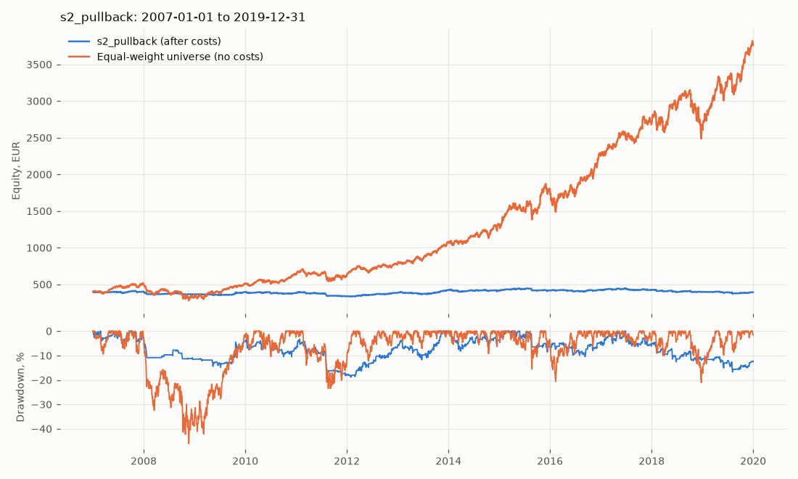

# Backtest: s2_pullback, insample (2007-01-01 to 2019-12-31)

Generated 2026-09-25 18:35 · code `75445e5c1b44` · docs/06 method

## Setup

- **Parameters:** `{"sma_n": 200, "rsi_n": 2, "rsi_entry": 10.0, "entry_rule": "rsi", "boll_n": 20, "boll_k": 2.0, "exit_sma_n": 5, "time_stop": 10, "atr_n": 14, "atr_mult": 2.5, "max_positions": 3, "max_position_eur": 200.0}`
- **Universe:** AAPL, MSFT, NVDA, AMZN, GOOGL, META, JPM, XOM, SAP, SIE, ALV, DTE, MUV2, BMW
- **Instruments starting later than the period:** META (2012-05-18)
- **Proxy history used:** none
- **Data:** Yahoo daily bars, dividend-adjusted, converted to EUR at ECB rates (docs/10 step 4)
- **Execution:** signal at close, entries as DAY limit (close + 1 %) at the next open, exits at the next open, resting stops (gap-through fills at the open). Costs per docs/06 §2.3, and again at 2×.
- Budget: €400 of the €1,000 cap.

## Metrics

| Metric | Strategy (1× costs) | Strategy (2× costs) | Benchmark |
|---|---|---|---|
| CAGR | -0.1% | -6.0% | +18.8% |
| Final equity, EUR | 394 | 180 | 3,764 |
| Sharpe (± standard error) | 0.02 ± 0.28 | -0.75 | 0.93 |
| Sortino | 0.03 | -1.00 |  |
| Volatility | 7.3% | 7.6% |  |
| Max drawdown | -18.8% | -56.3% | -46.1% |
| Longest drawdown, days | 1567 | 3353 |  |
| Calmar | -0.01 | -0.11 |  |
| Exposure (time invested) | 23% | 24% | 100% |
| Trades (open at end) | 935 (2) | 937 |  |
| Win rate | 61% | 56% |  |
| Avg win / avg loss, EUR | 1.56 / -2.49 | 1.02 / -1.81 |  |
| Profit factor | 0.99 | 0.71 |  |
| Avg bars held | 3.3 | 3.3 |  |
| Costs, EUR (% of gross P&L) | 275 (+102.4%) | 392 (+228.1%) |  |
| Turnover, x per year | 35.9 | 35.8 |  |
| Correlation / beta to benchmark | 0.41 / 0.15 |  |  |

Risk engine: 120 entry orders unfilled (gap above the limit); rejections: risk: daily loss limit ×26, sizing: below minimum order ×26.

Kill switch (drawdown ≥ 10 % of the strategy budget from peak) would have tripped on: **2008-01-22**. The backtest keeps trading after that date, so the full history stays visible. Live, trading would halt there.

## Returns per year

| Year | Strategy | Benchmark |
|---|---|---|
| 2007 | +0.6% | +25.2% |
| 2008 | -9.2% | -34.0% |
| 2009 | +8.2% | +52.1% |
| 2010 | -3.2% | +24.5% |
| 2011 | -11.4% | -2.3% |
| 2012 | +14.2% | +26.4% |
| 2013 | +9.5% | +38.3% |
| 2014 | -1.7% | +20.8% |
| 2015 | +0.4% | +36.5% |
| 2016 | +1.0% | +26.7% |
| 2017 | -0.3% | +19.1% |
| 2018 | -5.7% | -1.3% |
| 2019 | -0.9% | +42.2% |

## Trades

| Symbol | Trades | P&L, EUR | Win rate |
|---|---|---|---|
| SAP | 80.0 | -27.17 | 54% |
| DTE | 73.0 | -25.56 | 62% |
| XOM | 60.0 | -24.10 | 57% |
| ALV | 79.0 | -23.78 | 58% |
| NVDA | 63.0 | -19.66 | 54% |
| MUV2 | 72.0 | -13.11 | 58% |
| AMZN | 64.0 | -9.23 | 58% |
| BMW | 74.0 | +3.36 | 66% |
| GOOGL | 69.0 | +4.26 | 58% |
| MSFT | 64.0 | +12.76 | 61% |
| AAPL | 63.0 | +17.41 | 59% |
| SIE | 65.0 | +23.46 | 72% |
| JPM | 65.0 | +34.45 | 74% |
| META | 44.0 | +40.48 | 73% |

Exit reasons: close above SMA5 ×809, protective stop ×124, time stop 10 bars ×2

**Top 5 winners:** AMZN 2009-10-22→2009-10-26 +18.75 €; DTE 2013-08-07→2013-08-09 +8.15 €; SAP 2008-07-28→2008-07-30 +7.89 €; NVDA 2018-02-06→2018-02-08 +7.17 €; META 2017-10-26→2017-10-30 +7.10 €

**Top 5 losers:** NVDA 2015-08-20→2015-08-24 -9.97 €; ALV 2018-02-02→2018-02-06 -8.79 €; BMW 2018-02-01→2018-02-06 -8.20 €; AMZN 2019-07-30→2019-08-05 -7.78 €; DTE 2015-08-20→2015-08-24 -7.63 €

## Monte Carlo (1,000 reshuffles of the trade order)

Max drawdown: median €88, 95th percentile €134, worst €186 (closed-trade P&L, starting from €400).

