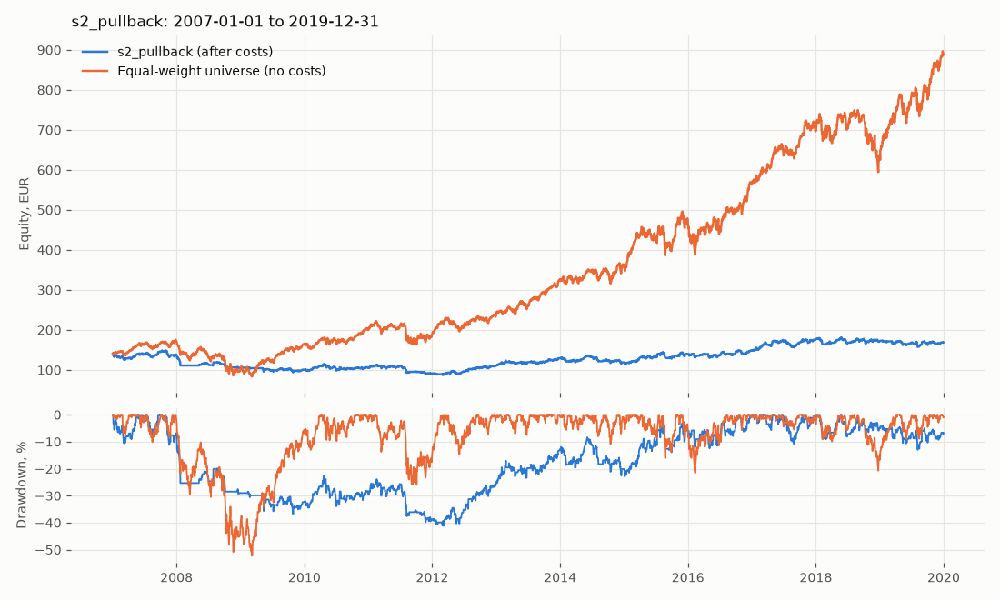

# Backtest: s2_pullback, insample (2007-01-01 to 2019-12-31)

Generated 2026-09-30 13:12 · code `9b74d98887a5` · docs/06 method

## Setup

- **Parameters:** `{"sma_n": 200, "rsi_n": 2, "rsi_entry": 10.0, "entry_rule": "rsi", "boll_n": 20, "boll_k": 2.0, "exit_sma_n": 5, "time_stop": 10, "atr_n": 14, "atr_mult": 2.5, "max_positions": 3, "max_position_eur": 200.0}`
- **Universe:** AAPL, MSFT, NVDA, AMZN, GOOGL, META, JPM, XOM, SAP, SIE, ALV, DTE, MUV2, BMW, ADS, IFX, DBK, MBG, BAS, RHM, AIR, DHL, BAYN, EOAN, DB1, ENR
- **Instruments starting later than the period:** META (2012-05-18), ENR (2020-09-29)
- **Proxy history used:** none
- **Data:** Yahoo daily bars, dividend-adjusted, converted to EUR at ECB rates (docs/10 step 4)
- **Execution:** signal at close, entries as DAY limit (close + 1 %) at the next open, exits at the next open, resting stops (gap-through fills at the open). Costs per docs/06 §2.3, and again at 2×.
- Budget: €140 of the €1,000 cap.

## Metrics

| Metric | Strategy (1× costs) | Strategy (2× costs) | Benchmark |
|---|---|---|---|
| CAGR | +1.5% | -6.0% | +15.2% |
| Final equity, EUR | 169 | 63 | 888 |
| Sharpe (± standard error) | 0.17 ± 0.28 | -0.36 | 0.77 |
| Sortino | 0.24 | -0.50 |  |
| Volatility | 13.8% | 14.0% |  |
| Max drawdown | -41.2% | -59.3% | -52.2% |
| Longest drawdown, days | 2313 | 3353 |  |
| Calmar | 0.04 | -0.10 |  |
| Exposure (time invested) | 43% | 42% | 100% |
| Trades (open at end) | 812 (2) | 713 |  |
| Win rate | 61% | 58% |  |
| Avg win / avg loss, EUR | 1.19 / -1.79 | 0.71 / -1.21 |  |
| Profit factor | 1.05 | 0.79 |  |
| Avg bars held | 3.4 | 3.3 |  |
| Costs, EUR (% of gross P&L) | 147 (+83.6%) | 166 (+186.9%) |  |
| Turnover, x per year | 65.5 | 62.6 |  |
| Correlation / beta to benchmark | 0.42 / 0.28 |  |  |

Risk engine: 107 entry orders unfilled (gap above the limit); rejections: sizing: below minimum order ×1100, cash at fill ×2, risk: daily loss limit ×57.

Kill switch (drawdown ≥ 10 % of the strategy budget from peak) would have tripped on: **2007-03-06**. The backtest keeps trading after that date, so the full history stays visible. Live, trading would halt there.

## Returns per year

| Year | Strategy | Benchmark |
|---|---|---|
| 2007 | -1.0% | +22.0% |
| 2008 | -23.8% | -40.7% |
| 2009 | -4.7% | +59.4% |
| 2010 | +4.6% | +22.5% |
| 2011 | -13.4% | -6.6% |
| 2012 | +21.7% | +27.4% |
| 2013 | +16.7% | +37.6% |
| 2014 | -8.2% | +9.4% |
| 2015 | +17.9% | +31.6% |
| 2016 | +6.3% | +19.8% |
| 2017 | +17.6% | +23.6% |
| 2018 | -1.9% | -9.3% |
| 2019 | -1.7% | +40.6% |

## Trades

| Symbol | Trades | P&L, EUR | Win rate |
|---|---|---|---|
| AMZN | 37.0 | -23.59 | 59% |
| XOM | 31.0 | -21.06 | 42% |
| SAP | 33.0 | -16.04 | 45% |
| MSFT | 32.0 | -15.29 | 53% |
| DTE | 40.0 | -7.50 | 62% |
| AIR | 26.0 | -5.53 | 46% |
| MUV2 | 35.0 | -4.68 | 60% |
| IFX | 34.0 | -3.47 | 74% |
| ADS | 47.0 | -2.43 | 60% |
| MBG | 20.0 | -1.51 | 50% |
| DHL | 35.0 | -0.04 | 57% |
| DBK | 19.0 | -0.01 | 42% |
| ALV | 29.0 | +1.73 | 66% |
| BMW | 29.0 | +4.07 | 72% |
| GOOGL | 38.0 | +4.10 | 63% |
| BAS | 25.0 | +4.91 | 64% |
| AAPL | 41.0 | +5.41 | 61% |
| JPM | 37.0 | +7.51 | 68% |
| BAYN | 30.0 | +7.75 | 63% |
| SIE | 26.0 | +7.95 | 62% |
| EOAN | 37.0 | +9.08 | 73% |
| NVDA | 38.0 | +17.55 | 63% |
| DB1 | 35.0 | +18.68 | 66% |
| RHM | 33.0 | +19.28 | 70% |
| META | 25.0 | +22.13 | 80% |

Exit reasons: close above SMA5 ×704, protective stop ×105, time stop 10 bars ×3

**Top 5 winners:** SAP 2008-07-28→2008-07-30 +6.79 €; BAS 2017-04-21→2017-04-25 +6.73 €; DB1 2019-08-29→2019-09-02 +5.66 €; ALV 2017-01-24→2017-01-26 +5.33 €; AMZN 2017-04-26→2017-04-28 +5.26 €

**Top 5 losers:** AMZN 2019-07-31→2019-08-05 -8.36 €; BAS 2018-02-02→2018-02-06 -7.95 €; DTE 2015-08-20→2015-08-24 -7.63 €; ADS 2016-10-26→2016-11-03 -6.88 €; JPM 2017-11-08→2017-11-15 -6.04 €

## Monte Carlo (1,000 reshuffles of the trade order)

Max drawdown: median €52, 95th percentile €80, worst €113 (closed-trade P&L, starting from €140).

