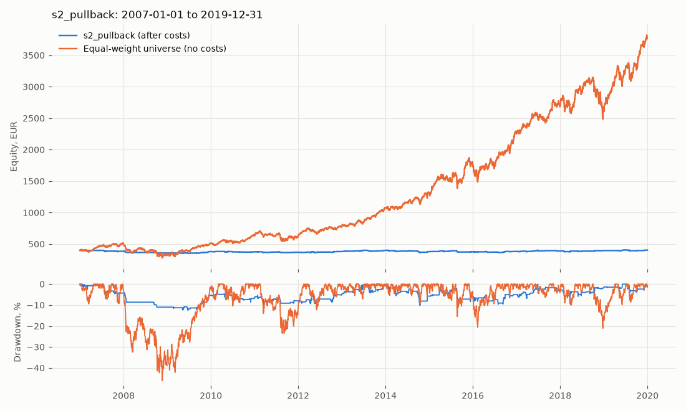

# Backtest: s2_pullback, insample (2007-01-01 to 2019-12-31)

Generated 2026-09-25 18:35 · code `0be3a594cfcb` · docs/06 method

## Setup

- **Parameters:** `{"sma_n": 200, "rsi_n": 2, "rsi_entry": 10.0, "entry_rule": "bollinger", "boll_n": 20, "boll_k": 2.0, "exit_sma_n": 5, "time_stop": 10, "atr_n": 14, "atr_mult": 2.5, "max_positions": 3, "max_position_eur": 200.0}`
- **Universe:** AAPL, MSFT, NVDA, AMZN, GOOGL, META, JPM, XOM, SAP, SIE, ALV, DTE, MUV2, BMW
- **Instruments starting later than the period:** META (2012-05-18)
- **Proxy history used:** none
- **Data:** Yahoo daily bars, dividend-adjusted, converted to EUR at ECB rates (docs/10 step 4)
- **Execution:** signal at close, entries as DAY limit (close + 1 %) at the next open, exits at the next open, resting stops (gap-through fills at the open). Costs per docs/06 §2.3, and again at 2×.
- Budget: €400 of the €1,000 cap.

## Metrics

| Metric | Strategy (1× costs) | Strategy (2× costs) | Benchmark |
|---|---|---|---|
| CAGR | +0.1% | -2.1% | +18.8% |
| Final equity, EUR | 404 | 302 | 3,764 |
| Sharpe (± standard error) | 0.04 ± 0.28 | -0.39 | 0.93 |
| Sortino | 0.06 | -0.53 |  |
| Volatility | 5.0% | 5.1% |  |
| Max drawdown | -12.5% | -28.0% | -46.1% |
| Longest drawdown, days | 1801 | 3345 |  |
| Calmar | 0.01 | -0.08 |  |
| Exposure (time invested) | 11% | 11% | 100% |
| Trades (open at end) | 395 (0) | 396 |  |
| Win rate | 62% | 58% |  |
| Avg win / avg loss, EUR | 1.67 / -2.65 | 1.29 / -2.41 |  |
| Profit factor | 1.01 | 0.75 |  |
| Avg bars held | 3.6 | 3.6 |  |
| Costs, EUR (% of gross P&L) | 110 (+96.4%) | 192 (+204.6%) |  |
| Turnover, x per year | 14.9 | 14.8 |  |
| Correlation / beta to benchmark | 0.31 / 0.08 |  |  |

Risk engine: 68 entry orders unfilled (gap above the limit); rejections: risk: daily loss limit ×2, sizing: below minimum order ×3.

Kill switch (drawdown ≥ 10 % of the strategy budget from peak) would have tripped on: **2008-10-03**. The backtest keeps trading after that date, so the full history stays visible. Live, trading would halt there.

## Returns per year

| Year | Strategy | Benchmark |
|---|---|---|
| 2007 | -3.9% | +25.2% |
| 2008 | -7.0% | -34.0% |
| 2009 | +6.3% | +52.1% |
| 2010 | -1.4% | +24.5% |
| 2011 | -1.3% | -2.3% |
| 2012 | +3.4% | +26.4% |
| 2013 | +4.4% | +38.3% |
| 2014 | -4.9% | +20.8% |
| 2015 | -0.5% | +36.5% |
| 2016 | +1.2% | +26.7% |
| 2017 | +1.5% | +19.1% |
| 2018 | +2.0% | -1.3% |
| 2019 | +1.9% | +42.2% |

## Trades

| Symbol | Trades | P&L, EUR | Win rate |
|---|---|---|---|
| GOOGL | 24.0 | -19.99 | 42% |
| ALV | 39.0 | -18.27 | 56% |
| XOM | 25.0 | -14.42 | 44% |
| AMZN | 27.0 | -14.05 | 59% |
| DTE | 30.0 | -13.14 | 53% |
| MUV2 | 33.0 | -7.64 | 61% |
| SIE | 24.0 | +1.48 | 67% |
| BMW | 30.0 | +5.26 | 70% |
| NVDA | 28.0 | +5.81 | 71% |
| SAP | 31.0 | +9.07 | 61% |
| META | 18.0 | +10.00 | 56% |
| JPM | 32.0 | +13.06 | 69% |
| MSFT | 26.0 | +22.84 | 73% |
| AAPL | 28.0 | +24.11 | 75% |

Exit reasons: close above SMA5 ×340, protective stop ×53, time stop 10 bars ×2

**Top 5 winners:** NVDA 2018-02-06→2018-02-08 +6.79 €; AAPL 2016-09-09→2016-09-14 +5.00 €; AAPL 2014-12-16→2014-12-18 +4.85 €; JPM 2014-07-09→2014-07-15 +4.60 €; JPM 2010-05-21→2010-05-24 +4.49 €

**Top 5 losers:** JPM 2012-05-07→2012-05-11 -8.37 €; AMZN 2015-08-21→2015-08-24 -8.00 €; DTE 2015-08-20→2015-08-24 -7.53 €; XOM 2016-07-28→2016-07-29 -5.72 €; GOOGL 2018-02-05→2018-02-06 -5.70 €

## Monte Carlo (1,000 reshuffles of the trade order)

Max drawdown: median €54, 95th percentile €80, worst €124 (closed-trade P&L, starting from €400).

