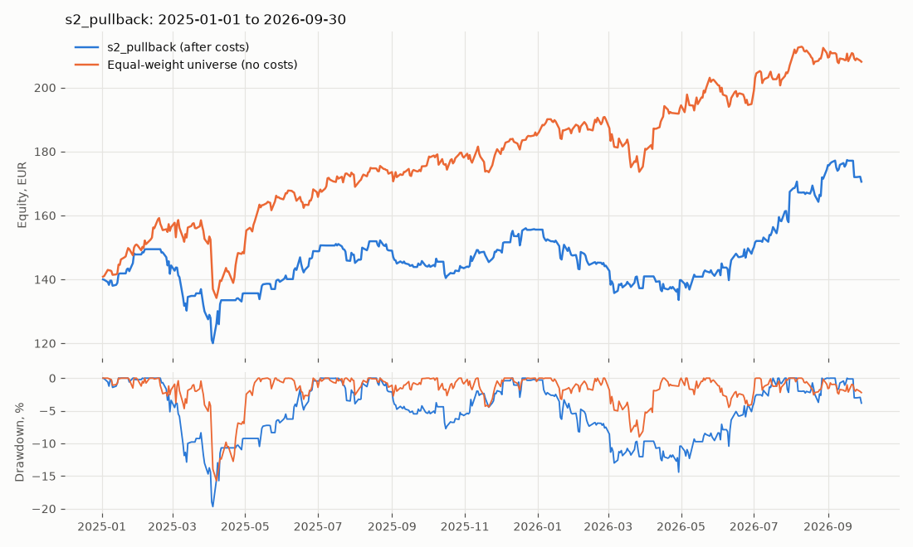

# Backtest: s2_pullback, recent (2025-01-01 to 2026-09-30)

Generated 2026-09-30 13:12 · code `9b74d98887a5` · docs/06 method

## Setup

- **Parameters:** `{"sma_n": 200, "rsi_n": 2, "rsi_entry": 10.0, "entry_rule": "rsi", "boll_n": 20, "boll_k": 2.0, "exit_sma_n": 5, "time_stop": 10, "atr_n": 14, "atr_mult": 2.5, "max_positions": 3, "max_position_eur": 200.0}`
- **Universe:** AAPL, MSFT, NVDA, AMZN, GOOGL, META, JPM, XOM, SAP, SIE, ALV, DTE, MUV2, BMW, ADS, IFX, DBK, MBG, BAS, RHM, AIR, DHL, BAYN, EOAN, DB1, ENR
- **Instruments starting later than the period:** none
- **Proxy history used:** none
- **Data:** Yahoo daily bars, dividend-adjusted, converted to EUR at ECB rates (docs/10 step 4)
- **Execution:** signal at close, entries as DAY limit (close + 1 %) at the next open, exits at the next open, resting stops (gap-through fills at the open). Costs per docs/06 §2.3, and again at 2×.
- Budget: €140 of the €1,000 cap.

## Metrics

| Metric | Strategy (1× costs) | Strategy (2× costs) | Benchmark |
|---|---|---|---|
| CAGR | +12.0% | -1.1% | +25.2% |
| Final equity, EUR | 171 | 137 | 208 |
| Sharpe (± standard error) | 0.71 ± 0.85 | 0.04 | 1.55 |
| Sortino | 1.11 | 0.05 |  |
| Volatility | 17.9% | 18.4% |  |
| Max drawdown | -19.7% | -21.9% | -15.7% |
| Longest drawdown, days | 145 | 415 |  |
| Calmar | 0.61 | -0.05 |  |
| Exposure (time invested) | 53% | 53% | 100% |
| Trades (open at end) | 151 (2) | 146 |  |
| Win rate | 64% | 58% |  |
| Avg win / avg loss, EUR | 1.52 / -2.08 | 1.40 / -1.92 |  |
| Profit factor | 1.28 | 0.99 |  |
| Avg bars held | 3.4 | 3.4 |  |
| Costs, EUR (% of gross P&L) | 27 (+45.7%) | 49 (+102.4%) |  |
| Turnover, x per year | 79.9 | 79.6 |  |
| Correlation / beta to benchmark | 0.37 / 0.45 |  |  |

Risk engine: 22 entry orders unfilled (gap above the limit); rejections: sizing: below minimum order ×142, risk: daily loss limit ×12.

Kill switch (drawdown ≥ 10 % of the strategy budget from peak) would have tripped on: **2025-03-10**. The backtest keeps trading after that date, so the full history stays visible. Live, trading would halt there.

## Returns per year

| Year | Strategy | Benchmark |
|---|---|---|
| 2025 | +11.1% | +31.4% |
| 2026 | +9.6% | +12.5% |

## Trades

| Symbol | Trades | P&L, EUR | Win rate |
|---|---|---|---|
| META | 7.0 | -10.28 | 71% |
| BAS | 9.0 | -6.26 | 44% |
| DB1 | 7.0 | -5.08 | 57% |
| GOOGL | 6.0 | -5.03 | 67% |
| MBG | 3.0 | -3.83 | 33% |
| AAPL | 12.0 | -3.63 | 42% |
| BAYN | 6.0 | -3.63 | 50% |
| BMW | 4.0 | -3.22 | 25% |
| JPM | 4.0 | -2.32 | 50% |
| ALV | 9.0 | -1.33 | 67% |
| SIE | 2.0 | -1.12 | 50% |
| MUV2 | 7.0 | -0.66 | 43% |
| SAP | 2.0 | +1.09 | 100% |
| XOM | 6.0 | +1.82 | 67% |
| MSFT | 6.0 | +3.44 | 83% |
| ADS | 2.0 | +4.12 | 100% |
| RHM | 7.0 | +4.52 | 86% |
| IFX | 4.0 | +4.65 | 75% |
| EOAN | 8.0 | +6.05 | 75% |
| NVDA | 4.0 | +6.14 | 100% |
| DTE | 5.0 | +6.31 | 100% |
| AIR | 8.0 | +6.92 | 75% |
| DBK | 5.0 | +7.29 | 80% |
| ENR | 3.0 | +8.07 | 100% |
| AMZN | 4.0 | +8.68 | 50% |
| DHL | 11.0 | +9.31 | 45% |

Exit reasons: close above SMA5 ×134, protective stop ×17

**Top 5 winners:** AMZN 2026-07-29→2026-07-31 +9.44 €; AIR 2026-07-21→2026-07-22 +5.44 €; ALV 2025-04-07→2025-04-11 +4.69 €; DBK 2025-04-07→2025-04-11 +4.60 €; DHL 2026-04-24→2026-05-04 +4.32 €

**Top 5 losers:** META 2026-07-23→2026-07-30 -7.16 €; SIE 2025-03-25→2025-04-03 -5.29 €; META 2025-02-20→2025-02-25 -5.25 €; JPM 2025-03-06→2025-03-10 -5.17 €; ALV 2026-09-23→2026-09-23 -5.13 €

## Monte Carlo (1,000 reshuffles of the trade order)

Max drawdown: median €22, 95th percentile €35, worst €47 (closed-trade P&L, starting from €140).

