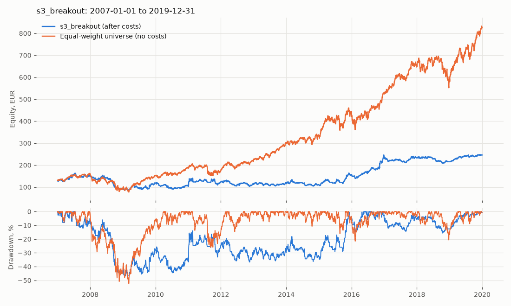

# Backtest: s3_breakout, insample (2007-01-01 to 2019-12-31)

Generated 2026-09-30 13:13 · code `9b74d98887a5` · docs/06 method

## Setup

- **Parameters:** `{"entry_n": 20, "exit_n": 10, "atr_n": 20, "atr_mult": 2.0, "max_positions": 2, "max_position_eur": 65.0}`
- **Universe:** AAPL, MSFT, NVDA, AMZN, GOOGL, META, JPM, XOM, SAP, SIE, ALV, DTE, MUV2, BMW, ADS, IFX, DBK, MBG, BAS, RHM, AIR, DHL, BAYN, EOAN, DB1, ENR
- **Instruments starting later than the period:** META (2012-05-18), ENR (2020-09-29)
- **Proxy history used:** none
- **Data:** Yahoo daily bars, dividend-adjusted, converted to EUR at ECB rates (docs/10 step 4)
- **Execution:** signal at close, entries as DAY limit (close + 1 %) at the next open, exits at the next open, resting stops (gap-through fills at the open). Costs per docs/06 §2.3, and again at 2×.
- Budget: €130 of the €1,000 cap.

## Metrics

| Metric | Strategy (1× costs) | Strategy (2× costs) | Benchmark |
|---|---|---|---|
| CAGR | +5.0% | +3.4% | +15.2% |
| Final equity, EUR | 246 | 200 | 825 |
| Sharpe (± standard error) | 0.35 ± 0.29 | 0.26 | 0.77 |
| Sortino | 0.52 | 0.39 |  |
| Volatility | 19.0% | 19.8% |  |
| Max drawdown | -46.8% | -52.8% | -52.2% |
| Longest drawdown, days | 2283 | 2408 |  |
| Calmar | 0.11 | 0.06 |  |
| Exposure (time invested) | 69% | 71% | 100% |
| Trades (open at end) | 236 (2) | 229 |  |
| Win rate | 37% | 36% |  |
| Avg win / avg loss, EUR | 5.37 / -2.42 | 4.83 / -2.28 |  |
| Profit factor | 1.32 | 1.21 |  |
| Avg bars held | 22.6 | 22.2 |  |
| Costs, EUR (% of gross P&L) | 37 (+24.4%) | 66 (+48.9%) |  |
| Turnover, x per year | 13.9 | 14.8 |  |
| Correlation / beta to benchmark | 0.48 / 0.44 |  |  |

Risk engine: 24 entry orders unfilled (gap above the limit); rejections: sizing: below minimum order ×31, risk: daily loss limit ×13.

Kill switch (drawdown ≥ 10 % of the strategy budget from peak) would have tripped on: **2007-07-31**. The backtest keeps trading after that date, so the full history stays visible. Live, trading would halt there.

## Returns per year

| Year | Strategy | Benchmark |
|---|---|---|
| 2007 | +19.6% | +22.0% |
| 2008 | -40.0% | -40.7% |
| 2009 | +26.1% | +59.4% |
| 2010 | -11.2% | +22.5% |
| 2011 | +18.0% | -6.6% |
| 2012 | -9.0% | +27.4% |
| 2013 | +3.8% | +37.6% |
| 2014 | -5.9% | +9.4% |
| 2015 | +42.5% | +31.6% |
| 2016 | +50.1% | +19.8% |
| 2017 | -0.6% | +23.6% |
| 2018 | -7.5% | -9.3% |
| 2019 | +14.1% | +40.6% |

## Trades

| Symbol | Trades | P&L, EUR | Win rate |
|---|---|---|---|
| JPM | 10.0 | -33.04 | 0% |
| SAP | 12.0 | -14.88 | 25% |
| XOM | 11.0 | -8.77 | 27% |
| MSFT | 10.0 | -7.39 | 20% |
| GOOGL | 9.0 | -7.20 | 44% |
| DTE | 14.0 | -7.07 | 36% |
| DBK | 9.0 | -5.76 | 22% |
| RHM | 11.0 | -5.65 | 45% |
| AIR | 11.0 | -4.43 | 36% |
| META | 7.0 | -4.10 | 29% |
| BMW | 10.0 | -3.70 | 40% |
| DHL | 5.0 | -1.41 | 60% |
| MUV2 | 7.0 | -1.10 | 29% |
| BAYN | 9.0 | +0.24 | 22% |
| EOAN | 8.0 | +0.83 | 38% |
| BAS | 5.0 | +1.38 | 40% |
| AAPL | 15.0 | +1.64 | 47% |
| SIE | 4.0 | +2.95 | 25% |
| IFX | 10.0 | +7.84 | 30% |
| MBG | 7.0 | +8.22 | 29% |
| ALV | 4.0 | +13.02 | 100% |
| AMZN | 13.0 | +17.26 | 54% |
| DB1 | 13.0 | +23.13 | 54% |
| ADS | 8.0 | +56.09 | 62% |
| NVDA | 14.0 | +86.83 | 43% |

Exit reasons: close below the 10-day low ×141, protective stop ×95

**Top 5 winners:** NVDA 2016-09-20→2017-01-18 +40.93 €; ADS 2016-02-19→2016-09-01 +33.99 €; NVDA 2011-01-04→2011-02-24 +23.17 €; AMZN 2009-09-23→2010-01-08 +20.45 €; NVDA 2015-09-28→2016-01-07 +20.29 €

**Top 5 losers:** JPM 2008-09-09→2008-09-16 -6.68 €; EOAN 2016-06-22→2016-06-24 -6.28 €; META 2012-10-25→2012-10-31 -5.40 €; JPM 2008-03-25→2008-04-14 -5.16 €; EOAN 2016-01-27→2016-02-09 -5.06 €

## Monte Carlo (1,000 reshuffles of the trade order)

Max drawdown: median €52, 95th percentile €84, worst €123 (closed-trade P&L, starting from €130).

