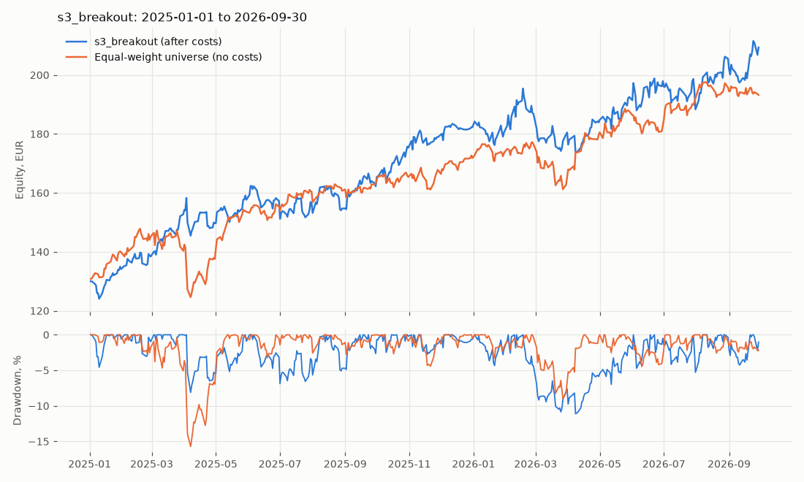

# Backtest: s3_breakout, recent (2025-01-01 to 2026-09-30)

Generated 2026-09-30 13:13 · code `9b74d98887a5` · docs/06 method

## Setup

- **Parameters:** `{"entry_n": 20, "exit_n": 10, "atr_n": 20, "atr_mult": 2.0, "max_positions": 2, "max_position_eur": 65.0}`
- **Universe:** AAPL, MSFT, NVDA, AMZN, GOOGL, META, JPM, XOM, SAP, SIE, ALV, DTE, MUV2, BMW, ADS, IFX, DBK, MBG, BAS, RHM, AIR, DHL, BAYN, EOAN, DB1, ENR
- **Instruments starting later than the period:** none
- **Proxy history used:** none
- **Data:** Yahoo daily bars, dividend-adjusted, converted to EUR at ECB rates (docs/10 step 4)
- **Execution:** signal at close, entries as DAY limit (close + 1 %) at the next open, exits at the next open, resting stops (gap-through fills at the open). Costs per docs/06 §2.3, and again at 2×.
- Budget: €130 of the €1,000 cap.

## Metrics

| Metric | Strategy (1× costs) | Strategy (2× costs) | Benchmark |
|---|---|---|---|
| CAGR | +31.5% | +35.4% | +25.2% |
| Final equity, EUR | 209 | 220 | 193 |
| Sharpe (± standard error) | 1.58 ± 1.14 | 1.76 | 1.55 |
| Sortino | 2.33 | 2.60 |  |
| Volatility | 17.9% | 17.7% |  |
| Max drawdown | -11.1% | -8.2% | -15.7% |
| Longest drawdown, days | 73 | 72 |  |
| Calmar | 2.84 | 4.34 |  |
| Exposure (time invested) | 72% | 73% | 100% |
| Trades (open at end) | 34 (2) | 32 |  |
| Win rate | 47% | 50% |  |
| Avg win / avg loss, EUR | 7.85 / -3.31 | 8.07 / -3.25 |  |
| Profit factor | 2.11 | 2.48 |  |
| Avg bars held | 22.4 | 24.1 |  |
| Costs, EUR (% of gross P&L) | 5 (+7.6%) | 10 (+11.7%) |  |
| Turnover, x per year | 13.9 | 13.0 |  |
| Correlation / beta to benchmark | 0.29 / 0.35 |  |  |

Risk engine: 10 entry orders unfilled (gap above the limit); rejections: risk: daily loss limit ×6, sizing: below minimum order ×2.

Kill switch (drawdown ≥ 10 % of the strategy budget from peak) would have tripped on: **2026-03-02**. The backtest keeps trading after that date, so the full history stays visible. Live, trading would halt there.

## Returns per year

| Year | Strategy | Benchmark |
|---|---|---|
| 2025 | +40.3% | +31.4% |
| 2026 | +14.8% | +12.5% |

## Trades

| Symbol | Trades | P&L, EUR | Win rate |
|---|---|---|---|
| XOM | 4.0 | -14.23 | 0% |
| RHM | 1.0 | -5.04 | 0% |
| AAPL | 1.0 | -3.50 | 0% |
| BAYN | 2.0 | -3.14 | 50% |
| BAS | 1.0 | -3.09 | 0% |
| DTE | 1.0 | -2.13 | 0% |
| MBG | 1.0 | -0.12 | 0% |
| IFX | 4.0 | +0.23 | 25% |
| ALV | 1.0 | +0.90 | 100% |
| JPM | 2.0 | +3.45 | 50% |
| DBK | 1.0 | +3.61 | 100% |
| ADS | 2.0 | +6.68 | 100% |
| AMZN | 1.0 | +7.21 | 100% |
| ENR | 4.0 | +7.56 | 50% |
| EOAN | 3.0 | +9.15 | 33% |
| SAP | 1.0 | +9.85 | 100% |
| DB1 | 2.0 | +11.29 | 100% |
| NVDA | 1.0 | +14.05 | 100% |
| GOOGL | 1.0 | +23.19 | 100% |

Exit reasons: close below the 10-day low ×18, protective stop ×16

**Top 5 winners:** GOOGL 2025-08-29→2025-11-17 +23.19 €; NVDA 2025-05-15→2025-08-20 +14.05 €; EOAN 2025-02-25→2025-05-14 +13.81 €; IFX 2026-05-06→2026-07-03 +11.88 €; ENR 2025-04-28→2025-06-11 +10.19 €

**Top 5 losers:** RHM 2025-04-16→2025-04-23 -5.04 €; XOM 2026-03-25→2026-04-08 -4.85 €; IFX 2025-07-09→2025-07-24 -4.68 €; ENR 2025-01-07→2025-01-08 -4.62 €; BAYN 2026-07-03→2026-07-08 -4.37 €

## Monte Carlo (1,000 reshuffles of the trade order)

Max drawdown: median €17, 95th percentile €29, worst €44 (closed-trade P&L, starting from €130).

