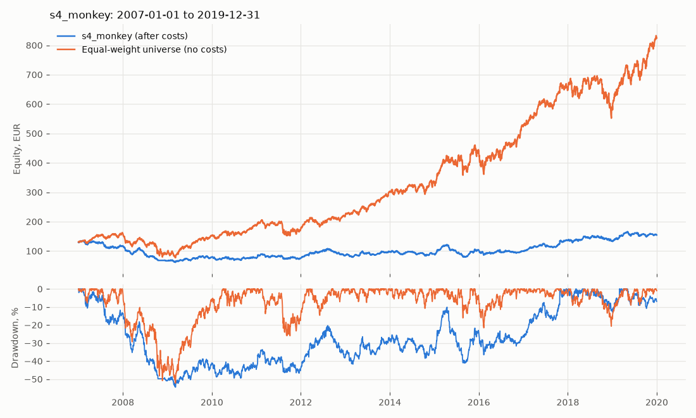

# Backtest: s4_monkey, insample (2007-01-01 to 2019-12-31)

Generated 2026-09-30 13:13 · code `9b74d98887a5` · docs/06 method

## Setup

- **Parameters:** `{"hold": 5, "atr_n": 14, "atr_mult": 2.5, "max_positions": 2, "max_position_eur": 65.0}`
- **Universe:** AAPL, MSFT, NVDA, AMZN, GOOGL, META, JPM, XOM, SAP, SIE, ALV, DTE, MUV2, BMW, ADS, IFX, DBK, MBG, BAS, RHM, AIR, DHL, BAYN, EOAN, DB1, ENR
- **Instruments starting later than the period:** META (2012-05-18), ENR (2020-09-29)
- **Proxy history used:** none
- **Data:** Yahoo daily bars, dividend-adjusted, converted to EUR at ECB rates (docs/10 step 4)
- **Execution:** signal at close, entries as DAY limit (close + 1 %) at the next open, exits at the next open, resting stops (gap-through fills at the open). Costs per docs/06 §2.3, and again at 2×.
- Budget: €130 of the €1,000 cap.

## Metrics

| Metric | Strategy (1× costs) | Strategy (2× costs) | Benchmark |
|---|---|---|---|
| CAGR | +1.3% | -12.2% | +15.2% |
| Final equity, EUR | 155 | 24 | 825 |
| Sharpe (± standard error) | 0.16 ± 0.28 | -0.63 | 0.77 |
| Sortino | 0.23 | -0.86 |  |
| Volatility | 18.1% | 17.6% |  |
| Max drawdown | -54.4% | -82.1% | -52.2% |
| Longest drawdown, days | 2771 | 3328 |  |
| Calmar | 0.02 | -0.15 |  |
| Exposure (time invested) | 74% | 71% | 100% |
| Trades (open at end) | 1121 (2) | 866 |  |
| Win rate | 51% | 47% |  |
| Avg win / avg loss, EUR | 1.32 / -1.32 | 0.87 / -0.99 |  |
| Profit factor | 1.04 | 0.77 |  |
| Avg bars held | 4.8 | 4.7 |  |
| Costs, EUR (% of gross P&L) | 135 (+83.7%) | 153 (+322.0%) |  |
| Turnover, x per year | 78.4 | 77.4 |  |
| Correlation / beta to benchmark | 0.61 / 0.53 |  |  |

Risk engine: 138 entry orders unfilled (gap above the limit); rejections: sizing: below minimum order ×962, risk: daily loss limit ×30, cash at fill ×10.

Kill switch (drawdown ≥ 10 % of the strategy budget from peak) would have tripped on: **2007-03-05**. The backtest keeps trading after that date, so the full history stays visible. Live, trading would halt there.

## Returns per year

| Year | Strategy | Benchmark |
|---|---|---|
| 2007 | -10.0% | +22.0% |
| 2008 | -42.7% | -40.7% |
| 2009 | +19.3% | +59.4% |
| 2010 | -5.8% | +22.5% |
| 2011 | +0.3% | -6.6% |
| 2012 | +11.9% | +27.4% |
| 2013 | +15.4% | +37.6% |
| 2014 | -8.2% | +9.4% |
| 2015 | +15.5% | +31.6% |
| 2016 | -2.8% | +19.8% |
| 2017 | +35.0% | +23.6% |
| 2018 | -0.8% | -9.3% |
| 2019 | +15.0% | +40.6% |

## Trades

| Symbol | Trades | P&L, EUR | Win rate |
|---|---|---|---|
| SIE | 55.0 | -19.20 | 40% |
| XOM | 62.0 | -12.38 | 40% |
| BAS | 55.0 | -11.62 | 44% |
| ALV | 50.0 | -11.25 | 48% |
| DBK | 41.0 | -11.16 | 41% |
| BAYN | 44.0 | -6.13 | 50% |
| META | 27.0 | -4.88 | 52% |
| GOOGL | 44.0 | -4.27 | 55% |
| AMZN | 41.0 | -3.92 | 44% |
| DHL | 42.0 | -2.71 | 45% |
| BMW | 41.0 | -2.06 | 51% |
| MBG | 28.0 | -0.18 | 43% |
| MUV2 | 49.0 | +0.45 | 55% |
| AIR | 43.0 | +0.98 | 53% |
| MSFT | 54.0 | +2.87 | 54% |
| SAP | 44.0 | +3.91 | 52% |
| DB1 | 51.0 | +4.10 | 53% |
| DTE | 48.0 | +5.60 | 44% |
| IFX | 45.0 | +6.41 | 53% |
| ADS | 47.0 | +6.59 | 55% |
| JPM | 40.0 | +7.00 | 57% |
| NVDA | 31.0 | +8.22 | 55% |
| EOAN | 44.0 | +9.73 | 57% |
| RHM | 54.0 | +26.84 | 65% |
| AAPL | 41.0 | +33.34 | 68% |

Exit reasons: time exit after 5 bars ×1013, protective stop ×108

**Top 5 winners:** AMZN 2017-10-25→2017-11-01 +9.07 €; IFX 2015-11-25→2015-12-02 +7.37 €; JPM 2017-11-27→2017-12-04 +6.37 €; RHM 2019-02-28→2019-03-07 +6.12 €; NVDA 2018-09-25→2018-10-02 +5.97 €

**Top 5 losers:** BAYN 2019-05-09→2019-05-14 -5.87 €; AMZN 2018-12-18→2018-12-24 -5.57 €; NVDA 2015-05-04→2015-05-08 -5.51 €; AMZN 2007-07-26→2007-08-01 -4.98 €; DHL 2008-01-17→2008-01-22 -4.56 €

## Monte Carlo (1,000 reshuffles of the trade order)

Max drawdown: median €55, 95th percentile €85, worst €107 (closed-trade P&L, starting from €130).

