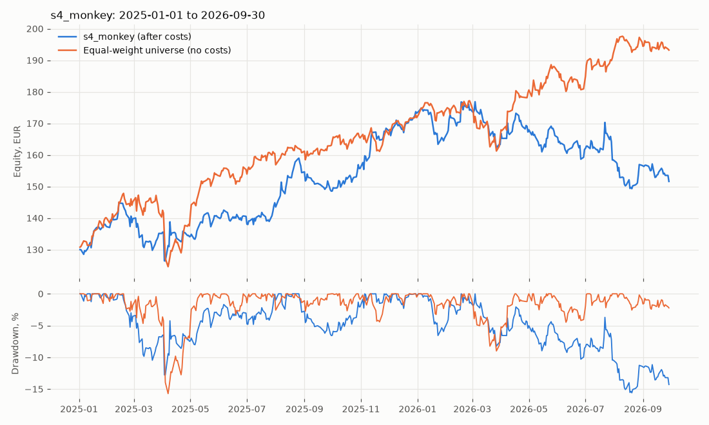

# Backtest: s4_monkey, recent (2025-01-01 to 2026-09-30)

Generated 2026-09-30 13:13 · code `9b74d98887a5` · docs/06 method

## Setup

- **Parameters:** `{"hold": 5, "atr_n": 14, "atr_mult": 2.5, "max_positions": 2, "max_position_eur": 65.0}`
- **Universe:** AAPL, MSFT, NVDA, AMZN, GOOGL, META, JPM, XOM, SAP, SIE, ALV, DTE, MUV2, BMW, ADS, IFX, DBK, MBG, BAS, RHM, AIR, DHL, BAYN, EOAN, DB1, ENR
- **Instruments starting later than the period:** none
- **Proxy history used:** none
- **Data:** Yahoo daily bars, dividend-adjusted, converted to EUR at ECB rates (docs/10 step 4)
- **Execution:** signal at close, entries as DAY limit (close + 1 %) at the next open, exits at the next open, resting stops (gap-through fills at the open). Costs per docs/06 §2.3, and again at 2×.
- Budget: €130 of the €1,000 cap.

## Metrics

| Metric | Strategy (1× costs) | Strategy (2× costs) | Benchmark |
|---|---|---|---|
| CAGR | +9.2% | -8.8% | +25.2% |
| Final equity, EUR | 152 | 111 | 193 |
| Sharpe (± standard error) | 0.60 ± 0.82 | -0.42 | 1.55 |
| Sortino | 0.88 | -0.60 |  |
| Volatility | 16.7% | 17.5% |  |
| Max drawdown | -15.6% | -26.4% | -15.7% |
| Longest drawdown, days | 148 | 282 |  |
| Calmar | 0.59 | -0.33 |  |
| Exposure (time invested) | 64% | 67% | 100% |
| Trades (open at end) | 169 (2) | 164 |  |
| Win rate | 47% | 44% |  |
| Avg win / avg loss, EUR | 1.94 / -1.47 | 1.66 / -1.49 |  |
| Profit factor | 1.19 | 0.88 |  |
| Avg bars held | 4.8 | 4.8 |  |
| Costs, EUR (% of gross P&L) | 23 (+48.7%) | 42 (+168.1%) |  |
| Turnover, x per year | 67.0 | 70.6 |  |
| Correlation / beta to benchmark | 0.46 / 0.52 |  |  |

Risk engine: 22 entry orders unfilled (gap above the limit); rejections: sizing: below minimum order ×21, risk: daily loss limit ×10.

Kill switch (drawdown ≥ 10 % of the strategy budget from peak) would have tripped on: **2025-03-11**. The backtest keeps trading after that date, so the full history stays visible. Live, trading would halt there.

## Returns per year

| Year | Strategy | Benchmark |
|---|---|---|
| 2025 | +33.3% | +31.4% |
| 2026 | -12.5% | +12.5% |

## Trades

| Symbol | Trades | P&L, EUR | Win rate |
|---|---|---|---|
| DHL | 12.0 | -9.30 | 25% |
| ADS | 5.0 | -7.97 | 40% |
| GOOGL | 4.0 | -7.94 | 25% |
| XOM | 6.0 | -4.42 | 33% |
| AAPL | 5.0 | -4.20 | 0% |
| MUV2 | 6.0 | -3.38 | 50% |
| MSFT | 8.0 | -3.11 | 38% |
| JPM | 7.0 | -2.52 | 43% |
| SIE | 5.0 | -1.97 | 40% |
| META | 3.0 | -1.37 | 0% |
| DTE | 8.0 | -0.39 | 50% |
| SAP | 3.0 | -0.36 | 67% |
| ENR | 5.0 | -0.30 | 40% |
| DB1 | 4.0 | +0.28 | 75% |
| BAS | 6.0 | +0.76 | 33% |
| AMZN | 12.0 | +1.53 | 42% |
| BMW | 8.0 | +2.02 | 50% |
| RHM | 5.0 | +2.51 | 40% |
| ALV | 8.0 | +3.24 | 62% |
| NVDA | 6.0 | +5.45 | 50% |
| BAYN | 9.0 | +6.52 | 33% |
| MBG | 5.0 | +6.56 | 60% |
| EOAN | 8.0 | +9.53 | 88% |
| IFX | 8.0 | +10.38 | 62% |
| DBK | 7.0 | +10.76 | 71% |
| AIR | 6.0 | +12.07 | 100% |

Exit reasons: time exit after 5 bars ×156, protective stop ×13

**Top 5 winners:** BAYN 2025-11-07→2025-11-14 +7.40 €; IFX 2026-05-18→2026-05-25 +6.95 €; AIR 2026-07-21→2026-07-28 +6.65 €; NVDA 2025-07-24→2025-07-31 +5.52 €; JPM 2025-04-07→2025-04-14 +5.04 €

**Top 5 losers:** ADS 2026-07-28→2026-07-30 -5.23 €; DHL 2025-03-27→2025-04-03 -5.22 €; NVDA 2026-07-27→2026-07-30 -5.19 €; ADS 2026-01-19→2026-01-23 -4.57 €; JPM 2025-04-02→2025-04-03 -4.47 €

## Monte Carlo (1,000 reshuffles of the trade order)

Max drawdown: median €23, 95th percentile €35, worst €47 (closed-trade P&L, starting from €130).

