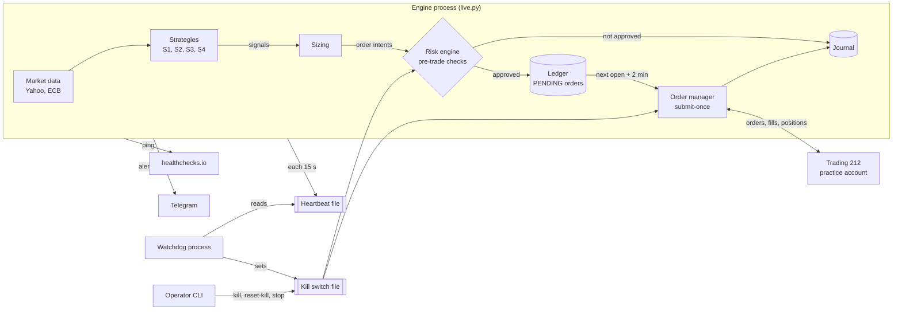

# TradeBot: Working Structure

| Item | Value |
|---|---|
| Language | ASD-STE100 Simplified Technical English. Section 16 gives the meaning of each technical name. |
| Date | 2026-10-03 |
| Phase | P1, the demo engine |
| Related documents | `README.md` and `docs/01` to `docs/10`. If this document and a design document do not agree, the design document is correct. |

## 1. Purpose of this document

This document tells you how TradeBot operates. It gives:

- The parts of the system and the function of each part.
- The sequence of operations in one day.
- The flow of one order, from a signal to a fill.
- The safety functions.
- The procedures for the operator.
- The procedures for fault isolation.

## 2. General description

TradeBot is a research prototype. It is an automated system that buys and sells stocks and ETFs on the Trading 212 practice account. The practice account uses demo money.

- Fixed rules (the strategies) make all trade decisions.
- The backtest and the engine use the same strategy code.
- A risk engine examines each order before the system sends it.
- The broker holds a protective stop for each open position.
- The total capital is €1,000 maximum. This value is "the cap".
- The broker adapter accepts only the address of the demo server. It does not accept the address of the live server.

These parts are not installed in phase P1:

- The LLM desk. Five language models can decrease or stop an S2 entry. They cannot make an order larger, and they cannot stop an exit. This part is for phase P2.
- The human approval gate. This part is for phase P3, with real money.

> **NOTE:** TradeBot is not investment advice. The project measures engineering quality and gives honest results. It does not promise a return.

## 3. Main parts

| Part | Function | File |
|---|---|---|
| Configuration | Gives the behaviour settings, the risk limits and the list of instruments. The engine reads them one time, at start. | `config/*.toml`, `config.py` |
| Market data | Downloads the daily bars from Yahoo and the FX rates from the ECB. Makes sure that the bars are correct. Keeps a cache. | `data.py` |
| Indicators | Calculates SMA, ATR, RSI, Bollinger bands and volatility. | `indicators.py` |
| Strategies | Read the bars and make signals. A signal is an entry, an exit or a trail. | `strategies.py` |
| Sizing | Changes a signal into an order intent, with a quantity and a price. | `sizing.py` |
| Risk engine | Does the pre-trade checks. It is the only part that can approve an order. It also keeps the kill switch. | `risk.py` |
| Order manager | Sends each order one time only. Records the fills. Keeps the protective stops. Compares the ledger with the broker. | `execution.py` |
| Broker adapter | Sends the requests to the Trading 212 API. Waits when the broker gives a rate limit. Gives the exchange calendar. | `trading212.py` |
| Engine | The main loop. Starts each operation at the correct time. | `live.py` |
| Journal and ledger | Records each event, order and lot in an SQLite database. | `store.py` |
| Watchdog | A separate process. Sets the kill switch if the engine stops without the `stop` command. | `watchdog.py` |
| Alerts | Sends messages to Telegram. Sends a ping to healthchecks.io. | `notify.py` |
| Backtester | Runs a strategy on historical data, with simulated fills and costs. Writes a report. | `backtest.py`, `sim.py`, `report.py` |
| Operator interface | Gives the commands for the operator. | `cli.py` |
| Scheduled tasks | Start the engine, the watchdog and the backup. | `ops/install-tasks.ps1` |

## 4. Rules of operation

1. **One door to the broker.** Only the order manager sends orders. Only the risk engine approves orders.
2. **One code path.** The engine and the backtest use the same strategy code. Only the clock, the data and the broker are different.
3. **The broker is the source of truth.** If the ledger and the broker do not agree, the system stops all new entries.
4. **Exits first.** The engine always sends the exits before the entries.
5. **Safe failure.** If there is a fault, the system stops new entries. The protective stops stay at the broker.
6. **Fixed limits.** The engine reads the risk limits at start. It makes sure that each limit is in its bounds, and it records their hash. The limits do not change while the engine operates.
7. **A full record.** The journal records each step. You can explain each order from the journal alone.

## 5. The sequence of one day

The times are Central European Summer Time (CEST). The engine gets the session times from the Trading 212 exchange schedules. Holidays, short sessions and the change of summer time need no change to the code.

| Time | Operation |
|---|---|
| Each 20 s | The engine loop starts one tick. If it is time for a sync, the engine does a sync (Section 6). |
| Each 15 s | The heartbeat thread writes `data/heartbeat.json`. |
| Each 2 min | A sync, while a market that the engine uses is open. |
| Each 10 min | A sync, while all these markets are closed. |
| Each 1 min | Task Scheduler starts the watchdog. |
| Each 5 min | Task Scheduler starts the engine. If the engine operates, Windows ignores this start. |
| 03:00 | Task Scheduler copies `data/demo.db` to `C:\TradeBotBackup`. |
| 09:00 | Xetra opens. |
| 09:02 | The engine sends the orders from the last decision cycle: first the exits, then the entries. When an entry fills, the engine sends a protective stop. |
| 17:20 | The engine sends no new orders in the last 10 minutes of the session. |
| 17:30 | Xetra closes. |
| 17:50 | The engine does the decision cycle for each strategy (Section 7). It prepares the orders for the next open. |
| 22:00 | The US market closes. |
| 22:30 | The engine writes the daily report to `reports/daily/<date>.md`. It sends a short summary to Telegram. |

Between the close and the next open, only the protective stops stay at the broker. If the engine stops during the night, no order is half-sent.

## 6. The sync

The sync is the main repeated operation. The engine does these steps in this sequence:

1. Get the exchange calendar from the broker. The engine does this step one time in 6 hours.
2. Find the orders with the status SUBMITTING or UNKNOWN. A crash can leave these orders. Resolve them with the submit-once protocol (Section 8.2).
3. Get the open orders, the order history and the positions from the broker. Write each change into the ledger.
   - An entry fill opens a lot.
   - A stop fill or an exit fill closes the lot and records the P&L.
4. Compare the ledger with the broker. This step is the reconciliation.
5. If the reconciliation finds a difference on two syncs in sequence, set the kill switch and stop the sync.
6. If the kill switch is set, cancel all entry orders.
7. Make sure that each open lot has one protective stop, with the correct price and quantity. Do this step only while the market of the lot is open.
8. If the clock difference to the broker is more than 2.5 s, send an alert and stop the sync. The engine sends no new orders until the clock is correct.
9. If the market is open, send the PENDING orders. "Open" is from 2 minutes after the open to 10 minutes before the close.
10. If the kill switch is not set, do the decision cycle for each strategy. The cycle starts only when it is due (Section 7).
11. If the US market closed more than 30 minutes before, and the daily report is not written, write it.
12. Send a ping to healthchecks.io.

If the sync fails, the engine records an ERROR event. Then it sends an alert and a "fail" ping.

> **NOTE:** The reconciliation needs two syncs in sequence before it sets the kill switch. After a fill, the broker updates the order history and the positions at different times. One difference can be a fill that is not complete yet.

## 7. The decision cycle

The engine does one decision cycle for each strategy after each session. The cycle starts 20 minutes after the close, when the daily bar is final. The engine does these steps:

1. Find the last closed session and the next session.
2. If the cycle for this session is done, stop.
3. If the time is more than 1 hour after the next open, record the cycle as "missed". Send an alert and stop.
4. Ask the strategy if this session is a check day. If it is not, record "not a check day" and stop.
5. Download the new bars.
6. Find the suspect bars. A bar is suspect if:
   - Its date is not the date of the closed session, or
   - The price changed by more than 25 % in one day.
7. If there are suspect bars, wait for correct data until 15 minutes before the next open. Then:
   - S1 does not do the cycle. Its weights use all six ETFs.
   - S2, S3 and S4 do the cycle without the suspect stocks. The engine sends an alert.
8. Calculate the equity of the book. If the equity is €100 or more below its peak, set the kill switch and stop.
9. Remove the stocks that a different strategy holds or prepares to buy. Each ticker has only one owner strategy and one protective stop.
10. Get the signals from the strategy. Sort them: exits first, then trails, then entries.
11. For each trail, move the stop of the lot up. The engine does not move a stop down.
12. For each entry, calculate the size (Section 9.2).
13. For each exit and entry, do the pre-trade checks (Section 10.2).
14. Record each risk decision in the journal.
15. Write each approved order into the ledger as PENDING, for the next session.

The operator can start a cycle out of its schedule with `cycle --strategy <name> --force`. If the command comes before the close, the engine keeps the request. It then does the cycle as a catch-up after the next close.

## 8. Orders

### 8.1 Order types

| Role | Type | Validity | Price | When the engine sends it |
|---|---|---|---|---|
| Entry | Limit buy | DAY | Last close + 1 % | Next open + 2 min |
| Exit | Market sell | — | — | Next open + 2 min. The engine first cancels the stop of the lot. |
| Protective stop | Stop sell | GTC | From the strategy (a multiple of the ATR) | After the entry fills. Only while the market is open. |

- If the price opens more than 1 % above the last close, the entry does not fill. The system does not pay a higher price.
- An entry quantity has 3 decimals. If the broker does not accept the precision, the order manager decreases the quantity to the precision in the error message. Then it sends the order again, one time only.
- A stop and an exit use the quantity that the broker filled.

### 8.2 Submit-once protocol

The Trading 212 API has no client order reference. If you send the same request two times, the broker can make two orders. For this reason, the order manager sends each order one time only:

1. Write SUBMITTING into the ledger before the request.
2. Send the request one time.
3. If the broker gives an order id, record SUBMITTED.
4. If the broker does not accept the order (HTTP 4xx), record BROKER_REJECTED. This result is final.
5. If there is a timeout, a server error (HTTP 5xx) or a connection error, do not send the request again. Record UNKNOWN.
6. For an UNKNOWN order, find the order in the open orders and in the order history. Do this two times, with 10 s between the two.
7. If the order manager finds the order, it records the broker id.
8. If the order manager does not find the order, it sends the order again. It does this one time only.
9. If the order is lost two times, set the kill switch.

Three BROKER_REJECTED results in sequence also set the kill switch.

### 8.3 Order states in the ledger

| State | Meaning |
|---|---|
| PENDING | The decision cycle approved the order. The engine sends it at the next open. |
| SUBMITTING | The engine started the request. It does not have the answer yet. |
| UNKNOWN | The request failed without a clear answer. The order manager must find the order (Section 8.2). |
| NEW, CONFIRMED | The broker has the order. |
| PARTIALLY_FILLED | The broker filled a part of the order. |
| FILLED | The broker filled the full order. |
| CANCELLED | The engine, the operator or the broker cancelled the order. |
| BROKER_REJECTED, REJECTED | The broker did not accept the order. |
| EXPIRED | A DAY order did not fill before the close. |
| SKIPPED | The engine did not send the order. Examples: the kill switch is set, the order missed its session, or the lot is already closed. |

## 9. Strategies and sizing

### 9.1 Strategies

The engine uses only EUR instruments on Xetra: 6 UCITS ETFs and 18 German stocks. The US stocks are only in the backtests.

| Strategy | Entry | Exit | Protective stop | Budget | Max positions | Gate status |
|---|---|---|---|---|---|---|
| S1 trend (6 UCITS ETFs) | On a check day (the last session of the month), buy each ETF with the close above its SMA(200). The weights are inverse to the volatility. | On a check day, sell each ETF with the close below its SMA(200). | Close − 3 × ATR(20). The stop moves up on each check day. | €600 | 6 | Passed the P0 gate |
| S2 pullback (18 stocks) | Close above SMA(200) and RSI(2) below 10. The lowest RSI goes first. | Close above SMA(5), or after 10 sessions. | Entry − 2.5 × ATR(14) | €140 | 3 | Failed the P0 gate. Demo experiment. |
| S3 breakout (18 stocks) | Close above the highest high of the last 20 sessions. The strongest breakout goes first. | Close below the lowest low of the last 10 sessions. | Entry − 2 × ATR(20) | €130 | 2 | Not tested against a gate. Demo experiment. |
| S4 monkey (18 stocks) | A random stock when a position is free. The date is the seed, so a backtest gives the same choice. | After 5 sessions. | Entry − 2.5 × ATR(14) | €130 | 2 | Control group |

> **NOTE:** S4 is the null hypothesis. If a strategy does not do better than random entries with the same exits and costs, it has no edge.

### 9.2 Sizing

1. Calculate the target value of the position:
   - S1: the budget × the weight of the ETF.
   - S2, S3 and S4: (0.5 % of the capital) ÷ (the stop distance) × (the price). At the €1,000 cap, this is €5 of risk.
2. Use the smallest of these values:
   - The target value.
   - The position cap of the strategy: S1 €250, S2 €200, S3 €65, S4 €65.
   - The global position cap, €250.
   - The cash in the budget of the strategy.
3. If the result is less than €20, do not make an order.

The capital is the smaller of €1,000 and (€1,000 × the strategy equity ÷ the strategy budget). After a loss, the risk for each trade decreases.

The engine calculates the value at the limit price, which is the highest possible fill price. A fill cannot go above a cap.

## 10. Risk limits and pre-trade checks

### 10.1 Risk limits (`config/risk.toml`)

| Limit | Value | Result if the system gets to the limit |
|---|---|---|
| Capital cap | €1,000 | No new entry above the cap |
| Max positions | 12 | No new entry |
| Max position | €250 | No larger entry |
| Min order | €20 | No smaller entry |
| Risk for each trade | 0.5 % of the cap (€5) | Used by the sizing |
| Max daily loss | 2 % of the cap (€20) | No new entries for that day |
| Max drawdown | 10 % of the cap (€100) | The kill switch is set |
| Max orders | 20 each day, 2 each minute | No new order |
| Price collar | 2 % | The limit price must be within 2 % of the last close |
| Short sales | Not permitted | A sell cannot be more than the holding |
| Whitelist | 32 instruments | No other instrument |

The engine does not start if a limit is out of its bounds in `config.py`.

### 10.2 Pre-trade checks

The risk engine does these checks in this sequence. The first check that fails stops the order. The journal records the reason.

1. The kill switch is not set.
2. The mode is known.
3. The market has a next session.
4. The instrument is on the whitelist.
5. A sell is not more than the holding.
6. The order intent is not a duplicate.
7. The number of orders is in the limits.
8. The last bar is not more than 5 days old.
9. The limit price is in the price collar.

For entries only:

10. The value is between €20 and €250.
11. The number of positions is less than the max. The new total value is not more than the cap.
12. The daily loss limit is not reached.
13. The budget of the strategy has enough cash.

Exits do not do checks 10 to 13, because an exit decreases the risk.

## 11. Safety functions

### 11.1 Kill switch

The kill switch is the file `data/KILL`. When a part of the system sets it (HALT), the system does these steps in this sequence:

1. The system writes the kill switch file. It does this step before all other steps.
2. The system writes a line in `data/kill_log.jsonl` and sends an alert.
3. The system cancels all entry orders at the broker and skips the PENDING entries.
4. The protective stops stay at the broker.

While the kill switch is set:

- The engine sends no new entries.
- The engine does no decision cycles.
- The engine continues the syncs and keeps the stops correct.
- The kill switch stays set after a restart. Only a person can reset it.

| Part that sets the kill switch | Cause |
|---|---|
| Operator | The `kill` command |
| Watchdog | The heartbeat is more than 60 s old |
| Engine | A reconciliation difference on two syncs in sequence |
| Engine | The equity is €100 or more below its peak |
| Engine | An order is lost two times (submit-once) |
| Engine | Three broker rejections in sequence |
| Engine | The broker does not accept a protective stop |
| Engine | Suspect data on two cycles in sequence, with open positions |
| Engine | An error in the risk engine |

### 11.2 Heartbeat and watchdog

- The engine writes the heartbeat file each 15 s.
- If the main loop does not move forward for 10 minutes, the heartbeat stops.
- Task Scheduler starts the watchdog each minute. The watchdog uses only the Python standard library, so it starts in approximately 1 s.
- If the heartbeat is more than 60 s old, the watchdog sets the kill switch and cancels the entry orders.
- The `stop` command writes "stopped" in the heartbeat. Then the watchdog does not set the kill switch.

### 11.3 Dead-man's switch

The engine sends a ping to healthchecks.io at the end of each sync. If the pings stop, healthchecks.io sends an alert. This function operates also when the full laptop is off.

### 11.4 Protective stops

Each open lot has one GTC stop at the broker. The stop protects the position also when the engine or the laptop is off. If a stop is not at the broker, the next sync replaces it and sends an alert.

### 11.5 Other safety functions

- **One engine only.** The `run` command does not start if a different engine has a new heartbeat. Two engines can send the same order two times.
- **Clock check.** The engine compares its clock with the time from the broker. The engine measures this value only from fast requests (less than 1 s).
- **Demo only.** The `run` command starts only with `mode = "demo"`. The broker adapter does not accept the live server.
- **Live arming (phase P3).** Real money needs three items: `mode = "live"`, the environment variable `TRADEBOT_LIVE`, and a live API key. If one item is not there, the engine does not start.

## 12. Data and files

| File or folder | Contents |
|---|---|
| `config/settings.toml` | The mode, the strategies that the engine uses, the budgets, the cost model and the backtest periods |
| `config/risk.toml` | The risk limits and the whitelist |
| `config/instruments.toml` | The instruments: symbol, ISIN, currency and the strategies that use the instrument |
| `config/t212_tickers.toml` | The Trading 212 ticker and the exchange schedule for each instrument |
| `.env` | The API keys, the Telegram token and the healthchecks.io address. Git does not track this file. |
| `data/demo.db` | The journal (`events`), the ledger (`orders`) and the lots (`lots`) |
| `data/research.db` | The cache of the daily bars, for the backtests and the engine |
| `data/heartbeat.json` | The time, the process id and the state of the engine |
| `data/KILL` | The kill switch. If this file is there, the kill switch is set. |
| `data/kill_log.jsonl` | Each set and each reset of the kill switch |
| `data/STOP` | The request from the `stop` command |
| `data/engine.log` | The console output of the engine |
| `data/trials.jsonl` | Each backtest run, with its parameters, results and code hash |
| `reports/` | The backtest reports and the data checks |
| `reports/daily/` | One daily report for each US session |
| `C:\TradeBotBackup\demo.db` | The backup copy, each night at 03:00 |

## 13. Operator procedures

All commands start with `uv run python -m tradebot`. Open a terminal in `D:\TradeBot` before you start a procedure.

> **CAUTION:** Do not buy or sell by hand in the Trading 212 practice account. The reconciliation finds the difference and sets the kill switch.

> **CAUTION:** Use only the `stop` command to stop the engine. If you stop the engine in a different way, the watchdog sets the kill switch.

> **CAUTION:** Do not send orders from a different process. Only the engine can send orders to the broker.

> **CAUTION:** Do not commit the `.env` file. Before each commit, make sure that no key or token is in the staged files.

| Command | Function |
|---|---|
| `status` | Shows the mode, the kill switch, the heartbeat, the last reconciliation, the equity, the open lots, the orders and the last alerts |
| `run` | Starts the engine. Task Scheduler usually does this. |
| `stop [--until HH:MM]` | Stops the engine in 20 s or less. With `--until`, the engine stays off until that time. |
| `kill --reason "..."` | Sets the kill switch |
| `kill --flatten --reason "..."` | Sets the kill switch and prepares a market exit for each lot at the next open |
| `reset-kill --who ... --reason ...` | Resets the kill switch. You must type `RESET`. |
| `reconcile` | Compares the ledger with the broker. Use it only when the engine is stopped. |
| `cycle --strategy <name> --force` | Does a catch-up decision cycle |
| `report` | Writes the daily report for the last US session |
| `watchdog` | Does one watchdog check |
| `data` | Downloads the market data and writes a data check report |
| `backtest --strategy <name> --period insample\|holdout\|recent\|all` | Runs a backtest and writes a report |
| `grid --strategy <name>` | Runs a backtest for each parameter set in the grid |

### 13.1 Examine the system (each day)

1. Type `uv run python -m tradebot status`.
2. Make sure that the kill switch is off.
3. Make sure that the heartbeat is less than 60 s old.
4. Make sure that the last reconciliation is OK.
5. Read the last daily report in `reports/daily/`.
6. Read the Telegram alerts.

### 13.2 Load a code update

1. Make sure that the tests pass: `uv run pytest`.
2. Type `uv run python -m tradebot stop`.
3. Wait 20 s.
4. Make sure that the heartbeat state is "stopped".
5. Wait for Task Scheduler. It starts the engine with the new code in 5 minutes or less.
6. Type `uv run python -m tradebot status`. Make sure that the engine operates.

### 13.3 Stop the engine for a planned pause

1. Type `uv run python -m tradebot stop --until HH:MM`.
2. Make sure that the heartbeat state is "stopped".
3. At the end of the pause, Task Scheduler starts the engine again.

### 13.4 Stop all new trades

1. Type `uv run python -m tradebot kill --reason "<your reason>"`.
2. If you also want to sell all positions at the next open, add `--flatten`.
3. Type `uv run python -m tradebot status`. Make sure that the kill switch is on.

### 13.5 Reset the kill switch

> **CAUTION:** Do not reset the kill switch before you know its cause and you correct it.

1. Type `uv run python -m tradebot status`. Read the reason for the kill switch.
2. Read the journal events and `data/engine.log` near that time.
3. Correct the cause.
4. If the engine is stopped, type `uv run python -m tradebot reconcile`. Make sure that the result is OK.
5. Type `uv run python -m tradebot reset-kill --who <name> --reason "<reason>"`.
6. Type `RESET` when the command asks.
7. Make sure that the next sync shows a correct reconciliation.

### 13.6 Do a catch-up decision cycle

Use this procedure only when a strategy lost its orders. Example: S1 lost its month-end entries on 2026-10-01.

1. Type `uv run python -m tradebot cycle --strategy <name> --force`.
2. If the time is before the close, the engine does the cycle after the close.
3. Read the CYCLE event in `status` or in the daily report.
4. Make sure that the orders go to the broker at the next open.

### 13.7 Install the scheduled tasks (one time only)

> **CAUTION:** This script changes system settings: the power plan, the time sync and the scheduled tasks. Only the owner does this procedure.

1. Type `uv sync` in `D:\TradeBot`.
2. Open PowerShell as administrator.
3. Type `powershell -ExecutionPolicy Bypass -File D:\TradeBot\ops\install-tasks.ps1`.
4. Make sure that the tasks "TradeBot engine", "TradeBot watchdog" and "TradeBot backup" are in Task Scheduler.
5. Type `uv run python -m tradebot status`.

## 14. Fault isolation

| Symptom | Possible cause | Action |
|---|---|---|
| Telegram: "KILL SWITCH tripped by watchdog" | The engine stopped, or the laptop restarted | Read `data/engine.log`. Make sure that the engine operates. Do procedure 13.5. |
| Telegram: "reconciliation mismatch" | An order or a position at the broker is not in the ledger | Examine the account in the Trading 212 app. Cancel each order that the engine did not send. Do procedure 13.5. |
| Telegram: "3 broker rejections in a row" | An error in the orders, for example the quantity precision | Read the BROKER_REJECTED events in the journal. Correct the code. Do procedures 13.2 and 13.5. |
| Telegram: "clock off by ... s" | The Windows time is not correct, or the laptop is slow because it has too little memory | Type `w32tm /resync`. Close large applications. |
| Telegram: "sync failed: ..." | A network fault, or a fault at the broker | Examine the network. The engine tries again at the next sync. |
| Telegram: "deciding without ..." or "cycle ... skipped" | Yahoo did not give the last bar | No action. Two such cycles with open positions set the kill switch. |
| Telegram: "... missed its session ...: skipped" | The engine was off at the open | No action. The strategy decides again at the next cycle. |
| Telegram: "protective stop ... disappeared at the broker" | A person or the broker cancelled the stop | No action. The engine replaced the stop. |
| healthchecks.io alert, but no Telegram messages | The laptop is off, or it does not operate correctly | Examine the laptop. After the restart, do procedure 13.5. |
| The engine does not start: "outside [...]" | A limit in `config/risk.toml` is out of its bounds | Put the limit back in its bounds. |
| The engine does not start: a different engine operates | A second engine has a new heartbeat | Use only one engine. |

> **NOTE:** The laptop is the weakest part of the system. On 2026-09-28 and 2026-09-29, low memory from desktop applications stopped the engine. Keep the browser and other large applications small while the engine operates.

## 15. Project phases and status

| Phase | Goal | Gate to the next phase | Status |
|---|---|---|---|
| P0 Foundations and backtest | Test the strategies offline, with costs | One strategy passes the "Idea → Demo" gate | Done 2026-09-25. S1 passed. S2 failed. |
| P1 Demo engine | Run the full loop with demo money | 2 weeks of correct runs without a person, and drills 1 to 8 pass | Built 2026-09-27. In operation since 2026-09-28. |
| P2 LLM desk (shadow) | Measure what each language model adds | "Demo → Gated live" | Not started |
| P3 Gated live (optional) | Real money in the €1,000 cap. A person approves each order. | "Gated → Bounded autonomy" | Only if the owner decides it |
| P4 Bounded autonomy (optional) | A person approves only the orders above a threshold | Stop criteria in `docs/06` | Only if the owner decides it |

Status at the daily report of 2026-10-02:

- The kill switch is off. The last reconciliation is OK.
- The book equity is €1,004.46. The peak is €1,004.46.
- There are 8 open lots: S1 has 4, S2 has 2, S4 has 2, and S3 has 0.
- Two orders are PENDING for the next session: an S2 exit (DHL) and an S3 entry (IFX).
- The forward check agrees for S1 and S3. It does not agree for S2 and S4.

## 16. Technical names

| Name | Meaning |
|---|---|
| ATR | Average True Range. The average daily price range. The strategies use it for the stop distance. |
| Backtest | A run of a strategy on historical data, with simulated fills and costs |
| Bar | The open, high, low and close prices and the volume of one instrument for one session |
| Book | All lots of all strategies together, in the €1,000 cap |
| Cap | The maximum capital, €1,000 |
| Check day | A session on which a strategy makes decisions. S1: the last session of the month. S2 to S4: each session. |
| DAY order | An order that the broker cancels at the close if it does not fill |
| Decision cycle | The steps after a close that change data into orders (Section 7) |
| Drawdown | The decrease of the equity from its peak |
| Entry | A buy order that opens a position |
| Exit | A sell order that closes a position |
| Fill | The broker did the order at a price |
| Forward check | A backtest over the live period. Its positions must agree with the positions of the engine. |
| GTC order | Good till cancelled. The order stays at the broker until it fills or someone cancels it. |
| HALT | The result when the kill switch is set (Section 11.1) |
| Heartbeat | A file that the engine writes each 15 s to show that it operates |
| Journal | The list of all events in `data/demo.db`. The system only adds to it. |
| Kill switch | A file that stops all new entries. The project documents also say "trip" for "set". |
| Ledger | The table of all orders and their states |
| Lot | One position from one entry fill, with its quantity, entry price, stop price and P&L |
| Order intent | A signal with a quantity and a price, before the risk check |
| P&L | Profit and loss |
| PENDING | An approved order that waits for the next open |
| Reconciliation | The comparison of the ledger with the orders and positions at the broker |
| RSI | Relative Strength Index. It shows if the price fell or rose quickly. |
| Session | The time from the open to the close of one exchange on one day |
| Shadow | A strategy that makes decisions but sends no orders |
| Signal | A decision of a strategy: entry, exit or trail |
| SMA | Simple Moving Average of the close prices |
| Stop (protective stop) | A sell order at the broker. It sells the position if the price falls to the stop price. |
| Suspect data | A bar with the incorrect date, or with a price change of more than 25 % in one day |
| Sync | The repeated operation that updates the ledger and sends orders (Section 6) |
| Trail | A signal that moves the stop of a lot up |
| UCITS ETF | An ETF that obeys the EU rules. Retail investors in the EU can buy it. |
| Whitelist | The list of instruments that the system can buy or sell |
| Xetra | The German stock exchange that the engine uses |
